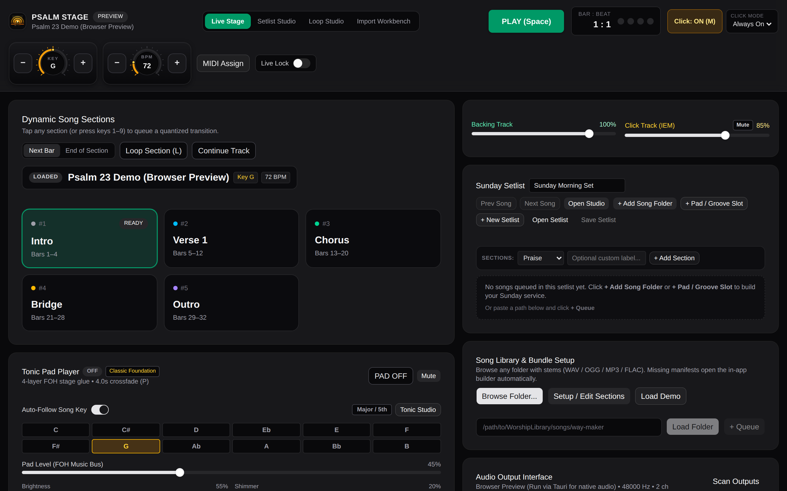
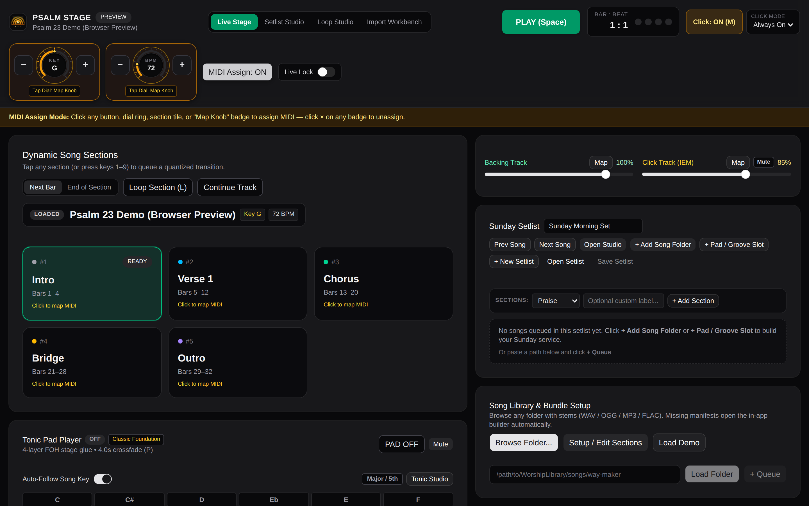
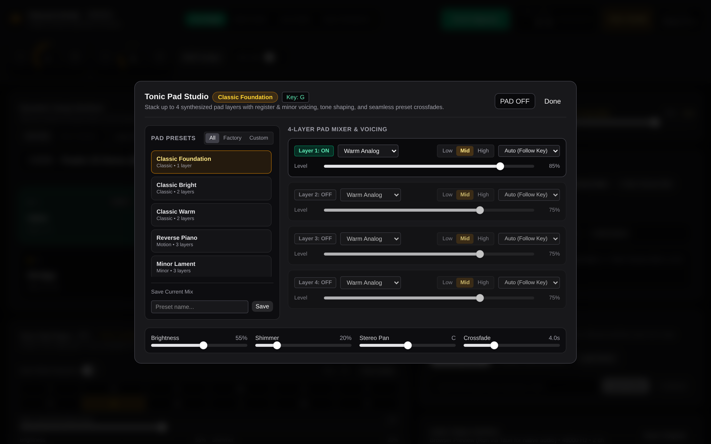
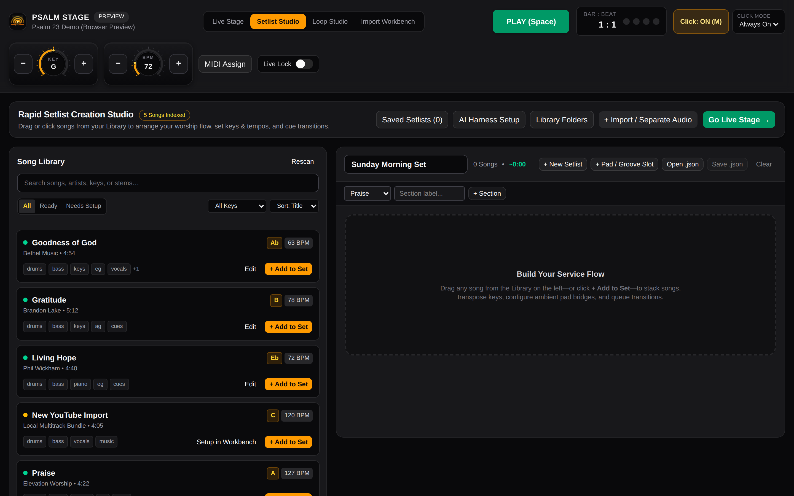
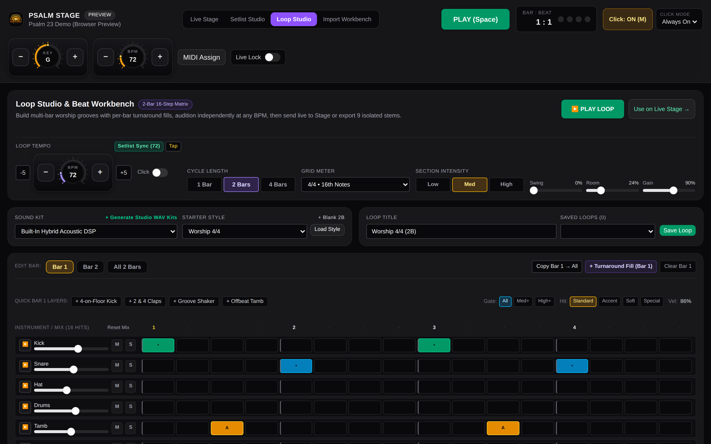
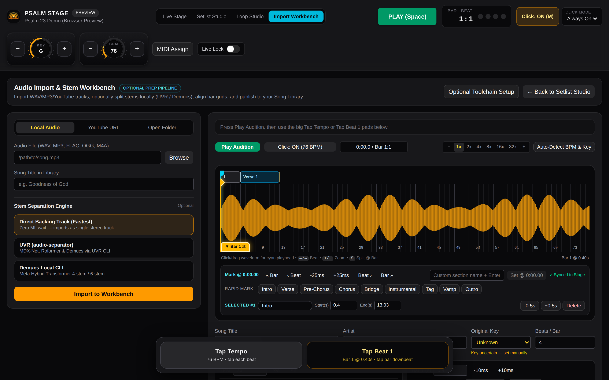

<p align="center">
  
</p>

<p align="center">
  <strong>High-Performance Live Worship Multitrack Playback & Stage Hardware Controller</strong><br>
  Built with <strong>Tauri v2</strong>, <strong>Rust</strong>, <strong>Angular 22</strong>, <strong>Tailwind CSS v4</strong>, and <strong>Spartan-ng (<code>vega</code>)</strong>.
</p>

<p align="center">
  
  
  
  
  
  
</p>

<p align="center">
  <a href="https://adedayo.github.io/psalm-stage/"><strong>Website & User Documentation</strong></a> ·
  <a href="https://github.com/adedayo/psalm-stage/releases"><strong>Download Installers</strong></a> ·
  <a href="CONTRIBUTING.md"><strong>Contributing</strong></a>
</p>

---

## Table of Contents

1. [📥 Quick Download & Installation (For Worship Teams)](#-quick-download--installation-for-worship-teams)
2. [Overview & Philosophy](#overview--philosophy)
3. [Key Capabilities](#key-capabilities)
4. [Workspace Architecture](#workspace-architecture)
5. [Hardware Setup & Stage Wiring](#hardware-setup--stage-wiring)
6. [Keyboard & MIDI Stage Controller Cheatsheet](#keyboard--midi-stage-controller-cheatsheet)
7. [OpenSpec Feature Pipeline & Specifications](#openspec-feature-pipeline--specifications)
8. [Documentation Directory](#documentation-directory)
9. [Developer Guide & Local Compilation](#developer-guide--local-compilation)
10. [Troubleshooting & Stage Safety](#troubleshooting--stage-safety)

---

## 📥 Quick Download & Installation (For Worship Teams)

> **No developer setup or terminal required!** Psalm Stage is distributed as standard, self-contained desktop installers for church laptops.

Visit the [**GitHub Releases**](https://github.com/adedayo/psalm-stage/releases) page (or the [**Psalm Stage Website**](https://adedayo.github.io/psalm-stage/)) to download the latest release:

<!-- AUTO-SYNC:START installers-table -->
| Platform | Installer Download | Installation Steps |
| :--- | :--- | :--- |
| **macOS (Apple Silicon)** | `Psalm.Stage_0.2.0_aarch64.dmg` | Open the `.dmg` file and drag **Psalm Stage** into your **Applications** folder. |
| **macOS (Intel Core)** | `Psalm.Stage_0.2.0_x64.dmg` | Open the `.dmg` file and drag **Psalm Stage** into your **Applications** folder. |
| **Windows 10 / 11** | `Psalm.Stage_0.2.0_x64-setup.exe` | Double-click the `.exe` installer. A desktop shortcut and Start menu entry are created automatically. |
| **Linux** | `Psalm.Stage_0.2.0_amd64.AppImage` | Right-click the `.AppImage`, enable "Allow executing file as program", and double-click to launch. |
<!-- AUTO-SYNC:END installers-table -->

> [!TIP] First-Time Launch Note (Free Open-Source Distribution)
> You do **not** need to buy any Apple or Microsoft developer licenses. Because Psalm Stage is distributed as free community software:
> * **macOS**: On first launch, if Gatekeeper shows *"Cannot verify developer"*, right-click (or Control-click) `Psalm Stage.app` in your **Applications** folder and select **Open**, then click **Open**. (Or go to **System Settings → Privacy & Security** and click **"Open Anyway"**). macOS remembers this permission permanently.
> * **Windows**: If Windows Defender SmartScreen displays *"Unknown Publisher"*, click **More info** $\to$ **Run anyway**.

For detailed packaging architecture, automated CI/CD release builds, and enterprise code-signing details, see [**docs/DEPLOYMENT_AND_RELEASES.md**](docs/DEPLOYMENT_AND_RELEASES.md).

---

## Overview & Philosophy

**Psalm Stage** is an open-source, deterministic live worship multitrack playback system and stage hardware controller. Designed for the high-stakes Sunday morning environment, Psalm Stage eliminates awkward silences, flams between metronome and stems, and subscription lock-in.

### Workspace Tour

<p align="center">
  
</p>

| Live Stage & MIDI Assign (Rotary Dials) | Tonic Pad Studio & Setlist Studio |
| :---: | :---: |
|  |  |
|  |  |
|  | |

### Core Architectural Invariants:
* **Zero-Latency Native Streaming**: When playing at native tempo and key (0 semitones shift), the audio engine completely bypasses STFT phase-vocoder spectral processing. Audio streams bit-perfect from memory with zero latency and zero transient smearing.
* **Deterministic Latency Compensation**: When dynamic time stretching or pitch shifting is engaged, the internal phase vocoder incurs an algorithmic delay ($5{,}760$ samples / $120\text{ ms}$ at $48\text{ kHz}$). Psalm Stage's synthesized metronome (click) and cue engine dynamically delay their impulse trains by the exact stretcher latency frame-for-frame, locking click, vocal cues, and music sample-for-sample.
* **Sub-Sample Fractional Tracking (Zero Drift)**: Playback frame cursors advance as 64-bit double precision floats ($f64$), preventing cumulative truncation drift even during multi-hour sets.
* **Open Song Packages**: No proprietary encrypted containers. Stems are standard WAV, FLAC, OGG, or MP3 files defined by an open, human-readable `manifest.json`.

---

## Key Capabilities

* **Sample-Accurate Metronome (`ClickSynth`)**: High-impact synthesized sine impulse clicks with accented downbeats ($1{,}600\text{ Hz}$ on beat 1, $800\text{ Hz}$ on beats 2–4). No audio sample jitter.
* **Dynamic Time Stretching & Transposition**: Real-time tempo adjustment (BPM) and harmonic transposition ($\pm 12$ semitones) via Signalsmith Stretch.
* **Intelligent Pitch-Preserving Stems**: Stems marked `"pitched": false` (drums, percussion, clicks, verbal guide cues) remain unshifted when transposing song keys, preventing snare distortion or unnatural vocal artifacts.
* **Quantized Section Navigation**: Jump to any section (Intro, Verse, Chorus, Bridge, Outro) quantized to the **Next Bar** downbeat or **End of Section**.
* **Seamless Infinite Looping**: Toggle infinite loop (`L` or MIDI footswitch) on any active section with equal-power crossfade boundaries to extend ministry or prayer times indefinitely.
* **Universal 2-Output Split L/R & Multi-Bus Matrix**:
  * **Split L/R Mode**: Left = FOH Music Stems, Right = IEM Click + Guide Cues. Works with any standard 2-channel USB audio interface (Focusrite Scarlett, Behringer U-Phoria, PreSonus AudioBox, MOTU M2/M4, Universal Audio Volt, Zoom, SSL, etc.).
  * **Multi-Out Mode**: Separate physical USB/Thunderbolt/Dante outputs for Stereo Tracks, Click, Cues, Bass, Drums, and Synths (Focusrite 18i20, Behringer X32/M32, MOTU Ultralite, Dante Virtual Soundcard).
* **Universal MIDI Controller & Keyboard Support with Hotplug Auto-Connect**:
  * **Automatic Connection**: Any class-compliant USB or 5-pin DIN MIDI keyboard (M-Audio, Arturia, Akai, Novation, Korg, Roland, Yamaha, Nektar), stage footswitch (Morningstar, Line 6 Helix, Hotone, Behringer), or fader bank connects automatically on app startup.
  * **Omni Input Mode**: Listens to all connected keyboards, floor pedals, and fader controllers simultaneously.
  * **Background Hotplug Detection**: Plug in or replug your MIDI keyboard while the software is running; it is detected and connected within seconds without restarting.
  * **One-Click MIDI Learn**: Map any key, drum pad, fader, or footswitch to transport, loop, section jump, tempo, key, or volume faders. Mappings persist locally in `~/.psalm-stage/midi-profile.json`.
* **High-Contrast Stage UI**: Spartan-ng (`vega`) unstyled primitives styled with Tailwind CSS v4 in high-visibility dark mode for dimly lit auditoriums.

---

## Workspace Architecture

```text
psalm-stage/
├── src/                               # Angular 22 Zoneless UI
│   ├── app/
│   │   ├── models/                    # TypeScript interfaces & command contracts
│   │   ├── services/                  # PsalmStageService (Signals & IPC bridge)
│   │   ├── ui/                        # Spartan-ng unstyled UI primitives
│   │   ├── app.ts                     # Stage Root Component & Keybindings
│   │   └── app.html                   # High-contrast live stage layout
│   └── styles.css                     # Tailwind CSS v4 design tokens
│
├── crates/psalm-audio-core/           # Pure Rust Real-Time Audio Engine
│   └── src/
│       ├── engine.rs                  # Real-time audio callback & state machine
│       ├── click.rs                   # Click impulse synth & latency delay line
│       ├── stretcher.rs               # Signalsmith phase vocoder integration
│       ├── routing.rs                 # Output channel matrix (Split L/R, Multi-Out)
│       ├── loader.rs                  # Symphonia stem decoder & linear resampler
│       ├── manifest.rs                # Song & setlist JSON manifest parser
│       └── midi.rs                    # Raw MIDI event decoder & binding engine
│
├── src-tauri/                         # Tauri v2 Desktop Bridge
│   └── src/
│       ├── lib.rs                     # IPC command handlers & telemetry loop
│       └── midi_manager.rs            # midir hardware port listener
│
├── docs/                              # In-Depth Architectural & Hardware Guides
│   ├── ARCHITECTURE.md                # Real-time threading model & lock-free queues
│   ├── AUDIO_ENGINE_DESIGN.md         # DSP latency compensation & sub-sample math
│   ├── HARDWARE_WIRING_GUIDE.md       # Focusrite Split L/R, DI boxes & console setup
│   ├── MIDI_MAPPING_GUIDE.md          # Footswitch binding & stage pedalboard setup
│   ├── SONG_BUNDLE_FORMAT.md          # Open manifest.json schema & audio codecs
│   └── TESTING_STRATEGY.md            # DSP invariant testing & CI standards
│
└── openspec/                          # OpenSpec Spec-Based Feature Pipeline
    ├── SPEC_PIPELINE.md               # Master roadmap, milestones & compliance
    └── specs/                         # Numbered feature specifications (SPEC-001..010)
```

---

## Hardware Setup & Stage Wiring

### Universal 2-Channel "Split L/R" Stage Interface Setup

Works with any standard 2-output USB audio interface (Focusrite Scarlett Solo/2i2, Behringer U-Phoria, PreSonus AudioBox, MOTU M2/M4, Universal Audio Volt, Zoom, SSL):

```text
[ Stage Laptop running Psalm Stage ]
             │ (USB-C)
             ▼
[ Standard 2-Output Audio Interface ]
             ├── Output 1 (Left TRS)  ──► [ Passive DI Box 1 ] ──► Snake Ch 1 ──► FOH PA + Band IEMs
             └── Output 2 (Right TRS) ──► [ Passive DI Box 2 ] ──► Snake Ch 2 ──► Band IEMs ONLY (MUTE ON FOH!)
```

> [!CAUTION] Stage Safety Checklist
> 1. Turn **Direct Monitor OFF** on your audio interface.
> 2. Ensure macOS **System Settings → Accessibility → Audio → "Play stereo audio as mono"** is **OFF**.
> 3. Verify on the stage mixing console that the Click/Cue channel is unassigned from the Main FOH Stereo bus!

Detailed wiring diagrams and multi-channel stage configurations are documented in [docs/HARDWARE_WIRING_GUIDE.md](docs/HARDWARE_WIRING_GUIDE.md).

---

## Keyboard & MIDI Stage Controller Cheatsheet

### Keyboard Controls
| Key | Action | Behavior |
| :--- | :--- | :--- |
| **`Space`** | Play / Stop | Starts playback or stops immediately |
| **`L`** | Toggle Loop | Arms active section to loop infinitely when reaching end bar |
| **`1` – `9`** | Queue Section #1–#9 | Quantized jump to Section 1 through 9 |

### Hardware MIDI Controllers & Keyboards
1. **Zero-Config Auto-Connect**: Plug in your USB MIDI keyboard (e.g. M-Audio Oxygen, Arturia KeyLab, Novation Launchkey) or stage pedalboard (Morningstar MC6, Line 6 Helix, Hotone Ampero). Psalm Stage **auto-detects and connects** immediately in **Omni Mode** (listening to all connected inputs simultaneously).
2. **Live Visual Activity Feedback**: The green indicator pulses on every keypress, fader movement, or footswitch tap, displaying the note name (e.g. `Note C4 (60)`), velocity, and channel.
3. **One-Click MIDI Learn**:
   - Click **MIDI Assign** in the top navigation bar (yellow learn badges appear).
   - Click any on-screen button, section tile, or fader `Map Knob` badge.
   - Tap a physical key, drum pad, footswitch, or turn a knob to bind it.
   - Toggle **MIDI Assign** off to lock your bindings. All mappings persist locally in `~/.psalm-stage/midi-profile.json`.

Read the complete guide in [docs/MIDI_MAPPING_GUIDE.md](docs/MIDI_MAPPING_GUIDE.md).

---

## OpenSpec Feature Pipeline & Specifications

Psalm Stage uses an OpenSpec specification pipeline to govern feature design, DSP invariants, and testing requirements:

* [**OpenSpec Pipeline Master Roadmap**](openspec/SPEC_PIPELINE.md)
* [**SPEC-001: Audio Engine & DSP Stretcher**](openspec/specs/SPEC-001-AUDIO-ENGINE.md) — Real-time audio loop, zero-latency bypass, latency compensation delay line.
* [**SPEC-002: Click Engine & Output Matrix**](openspec/specs/SPEC-002-CLICK-AND-ROUTING.md) — Synthesized impulse metronome, Split L/R, and multi-channel routing.
* [**SPEC-003: Arrangement & Quantization**](openspec/specs/SPEC-003-ARRANGEMENT-QUANTIZATION.md) — Bar-accurate section markers, Next Bar quantization, infinite looping.
* [**SPEC-004: Multi-Song Setlist Flow**](openspec/specs/SPEC-004-SETLIST-FLOW.md) — Setlist manifests, key/tempo overrides, AutoAdvance, AutoPause.
* [**SPEC-005: Hardware MIDI Stage Control**](openspec/specs/SPEC-005-MIDI-STAGE-CONTROL.md) — Universal MIDI learn, footswitch bindings, Live Lock.
* [**SPEC-006: Library Bundle & Stem Decoder**](openspec/specs/SPEC-006-LIBRARY-BUNDLE-SYSTEM.md) — `manifest.json` schema, audio decoding, linear resampling.
* [**SPEC-007: Ambient Drone Pads**](openspec/specs/SPEC-007-CONTINUOUS-PADS.md) — Continuous stage glue pads across all 12 keys, cross-key crossfades.
* [**SPEC-008: High-Contrast Stage UI**](openspec/specs/SPEC-008-STAGE-UI-SPARTAN.md) — Angular 22 zoneless architecture, Spartan-ng components.
* [**SPEC-009: Outbound MIDI Beat Clock & Automation**](openspec/specs/SPEC-009-MIDI-CLOCK-AUTOMATION.md) — 24 PPQN MIDI clock out, ProPresenter automation.
* [**SPEC-010: Offline Caching & Non-Destructive Overrides**](openspec/specs/SPEC-010-CLOUD-SYNC-OFFLINE.md) — Local-first offline sidecar files.
* [**SPEC-011: Automated Packaging & Distribution Pipeline**](openspec/specs/SPEC-011-PACKAGING-AND-DISTRIBUTION.md) — Turnkey `.dmg`, `.exe`, `.deb` installers, and CI/CD release workflow.

---

## Documentation Directory

Explore the deep architectural and operational guides in `docs/`:

* [docs/DEPLOYMENT_AND_RELEASES.md](docs/DEPLOYMENT_AND_RELEASES.md) — Turnkey installer distribution, GitHub Actions CI/CD, signing, and auto-updates.
* [docs/ARCHITECTURE.md](docs/ARCHITECTURE.md) — Threading model, lock-free ringbuffers, real-time invariants.
* [docs/AUDIO_ENGINE_DESIGN.md](docs/AUDIO_ENGINE_DESIGN.md) — DSP signal processing graph, latency matching proof, sub-sample math.
* [docs/HARDWARE_WIRING_GUIDE.md](docs/HARDWARE_WIRING_GUIDE.md) — Audio interface setup, passive DI boxes, digital console routing.
* [docs/MIDI_MAPPING_GUIDE.md](docs/MIDI_MAPPING_GUIDE.md) — Pedalboard layouts, MIDI message kinds, troubleshooting.
* [docs/SONG_BUNDLE_FORMAT.md](docs/SONG_BUNDLE_FORMAT.md) — Full manifest specification, codecs, and directory layout.
* [docs/TOOLCHAIN_SETUP_GUIDE.md](docs/TOOLCHAIN_SETUP_GUIDE.md) — Optional macOS, Windows, and Linux setup for `yt-dlp`, `ffmpeg`, UVR (`audio-separator`), and `demucs`.
* [docs/TESTING_STRATEGY.md](docs/TESTING_STRATEGY.md) — Headless DSP test methodology, float drift assertions, CI matrix.

---

## Developer Guide & Local Compilation

> Note: This section is intended for developers contributing to the codebase. Worship teams and musicians should download the ready-to-run installers above.

### Prerequisites
* **Node.js**: v22+ (`node -v`)
* **Rust**: 1.80+ (`rustc -vV`)
* **macOS / Linux / Windows** build dependencies for Tauri v2

### Running in Development Mode
```bash
# 1. Install dependencies
npm install

# 2. Run in desktop development mode (Tauri v2 + Angular 22)
npm run tauri dev
```

> [!NOTE] Port 4200 Auto-Recycling
> The `package.json` includes an automatic `prestart` hook that clears lingering processes on port 4200 before Angular starts, preventing connection collisions.

### Building Desktop Installers Locally
```bash
# Compiles optimized release binary and bundles native .dmg / .exe installer
npm run package
```

### Running Test Suites
```bash
# Run all 25 Rust audio core unit tests
cargo test --workspace

# Run all 7 Angular frontend unit tests
npx ng test --watch=false

# Run Angular production build verification
npm run build
```

---

## Troubleshooting & Stage Safety

* **Metronome and stems flamming or out of sync**: Verify that you are running the latest build with `ClickDelayBuffer` latency compensation active. Run `cargo test -p psalm-audio-core --lib engine::tests::test_sync_between_music_and_click_with_tempo_change` to verify sample accuracy.
* **Editor buffer revert on save**: If editing files in an external IDE while an automated task runs, use `File: Revert File` (`Cmd+Shift+P` in VS Code / Antigravity) to reload clean disk contents from Git rather than saving stale in-memory buffers.
* **Click audible in house speakers**: Your audio interface is set to Mono, or the stage console has not unassigned Output 2 (Right) from the Main PA bus. See [docs/HARDWARE_WIRING_GUIDE.md](docs/HARDWARE_WIRING_GUIDE.md).

---

## License

Psalm Stage is released under the [BSD 3-Clause License](LICENSE). Copyright © 2026 Dr. Dayo Adetoye. Open source, community owned, and built for worship teams.
