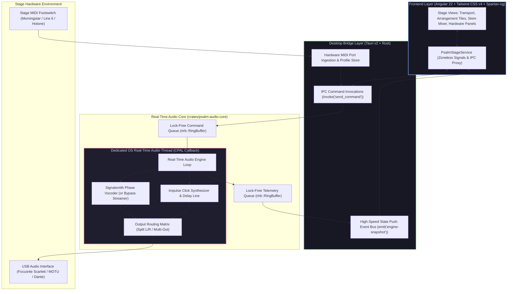

# System Architecture: Psalm Stage

Psalm Stage is an open-source, low-latency live worship stage playback system and hardware controller. It is engineered with a strict real-time audio thread boundary, a lightweight Tauri v2 system bridge, and a high-performance zoneless Angular 22 user interface.

---

## 1. High-Level Architectural Layers

---

## 2. The Real-Time Threading Model

Real-time audio processing operates under extreme time constraints. At a typical buffer size of $256\text{ samples}$ at $48\text{ kHz}$, the audio callback has exactly **$5.33\text{ ms}$** to calculate and deliver output audio. Exceeding this budget by even a microsecond causes a buffer underrun, heard by musicians and audience as a loud click or dropout.

To guarantee zero glitches, Psalm Stage enforces standard professional DSP invariants:

### 2.1 Audio Thread Invariants
On the dedicated audio thread (`engine.rs` CPAL callback):
1. **NO Memory Allocation / Deallocation**: No `malloc`, `free`, `Box::new`, or expanding `Vec`. All audio buffers, stretcher working memory, and scratch slices are pre-allocated during song load.
2. **NO Blocking Synchronization**: No blocking mutexes (`std::sync::Mutex`, `RwLock`). Thread communication is strictly asynchronous through single-producer single-consumer lock-free ringbuffers (`rtrb`).
3. **NO File System or Network I/O**: Files are decoded completely in background worker threads before live playback begins.
4. **NO Unbounded System Calls**: No logging (`println!`, `tracing::info!`), no thread spawning, and no dynamic library calls.

### 2.2 Thread Communication Flow

- **UI $\to$ Audio Thread (Commands)**:
  Commands (`Play`, `Stop`, `QueueSection`, `SetKeyShift`, `SetBpm`, `SetStemGain`) are enqueued into an `rtrb::Producer<EngineCommand>`.
  At the start of every audio callback slice, the audio thread drains pending commands non-blockingly via `.pop()`.
- **Audio Thread $\to$ UI (Telemetry)**:
  At the conclusion of each buffer calculation, the audio thread pushes an `EngineSnapshot` into an `rtrb::Producer<EngineSnapshot>`.
  A lightweight background telemetry thread consumes this queue at ~30Hz and emits Tauri events to the Angular UI.

---

## 3. Frontend Architecture (Angular 22 Zoneless)

The UI layer is built on **Angular 22** without Zone.js:
- **Reactivity Model**: State management utilizes native Angular Signals (`signal<EngineSnapshot>()`, `computed()`).
- **High Framerate Telemetry**: High-frequency position ticks from the audio thread update internal signals without triggering global zone re-evaluations.
- **Component Primitives**: UI components utilize Spartan-ng (`vega`) unstyled primitives styled with Tailwind CSS v4 for razor-sharp visual clarity on dimly lit stages.

---

## 4. Hardware MIDI Architecture

Hardware MIDI input is managed by `midir` running in `src-tauri/src/midi_manager.rs`:
1. Devices can be plugged in or unplugged dynamically without restarting the application.
2. Incoming raw byte packets are parsed into normalized `RawMidiEvent` structures (Channel, Kind, Number, Value).
3. The MIDI dispatcher checks the active `MidiProfile`. If an event matches a bound control, it translates it directly into an `EngineCommand` and enqueues it to the audio thread.
4. If **MIDI Learn Mode** is active, the raw event is routed to the UI so the musician can link it to the selected on-screen parameter.

