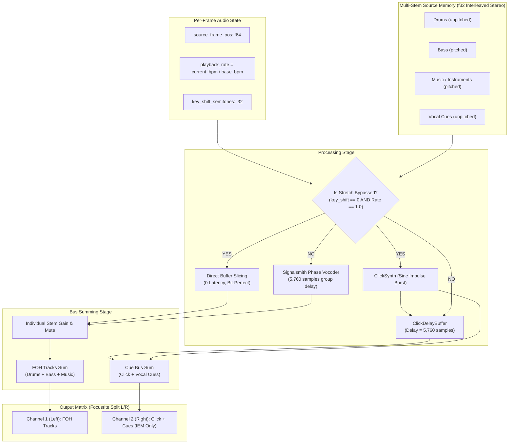

# Audio Engine & DSP Design: Psalm Stage

This document details the signal processing pipeline, algorithmic latency compensation, sub-sample phase tracking, and bit-perfect streaming design within `crates/psalm-audio-core`.

---

## 1. Real-Time Signal Processing Graph

The audio callback executes deterministically for each output buffer slice delivered by the operating system audio backend (`cpal` on CoreAudio, ALSA, or WASAPI):



---

## 2. Algorithmic Latency & The Metronome Flam Problem

### 2.1 The Problem
High-quality time stretching and pitch transposition requires an STFT phase vocoder. Psalm Stage uses `signalsmith-stretch`, which provides transparent pitch shifting with clean transients.

However, STFT processing requires analysis and synthesis windows. At $48\text{ kHz}$:
- **Input buffer latency**: $2{,}880\text{ samples}$ ($60\text{ ms}$)
- **Output buffer latency**: $2{,}880\text{ samples}$ ($60\text{ ms}$)
- **Total Algorithmic Group Delay**:
  $$\tau_{\text{stretcher}} = 2{,}880 + 2{,}880 = 5{,}760\text{ samples} \quad (120\text{ ms})$$

If an audio engine renders the metronome click at frame 0 when a downbeat occurs, but the backing track audio emerges from the stretcher at frame $5{,}760$, the click sounds **$120\text{ ms}$ earlier** than the kick drum and guitars. On stage, this creates a severe audible flam that makes playing along impossible.

### 2.2 The Solution: Dynamic Latency Compensation
Psalm Stage resolves this with an exact delay alignment mechanism:

1. **Native Playback Bypass**:
   When the song is played at its native recorded tempo and key ($0\text{ semitones}$ shift), `is_stretch_bypassed()` evaluates to `true`.
   Audio stems completely bypass the vocoder buffers and stream directly from memory.
   The metronome click is routed directly to the cue bus with zero delay.
   **Result**: Zero latency, pristine transients, zero CPU overhead.

2. **Compensated Stretch Playback**:
   When the user changes the tempo or pitch:
   Stems pass through the phase vocoder, incurring $\tau_{\text{stretcher}} = 5{,}760\text{ samples}$.
   The metronome click is passed through a circular ringbuffer delay line (`ClickDelayBuffer`) configured to precisely $\tau_{\text{stretcher}}$ samples:
   $$y[n] = x[n - \tau_{\text{stretcher}}]$$
   **Result**: Click and music emerge at the physical output converters on the exact same audio frame.

---

## 3. Sub-Sample Fractional Cursor Tracking (Anti-Drift)

When tempo stretching audio, the fractional position in the source audio advance per output sample is:
$$\Delta s = \frac{\text{Current BPM}}{\text{Native BPM}}$$

At 80 BPM playing a 72 BPM song:
$$\Delta s = \frac{80}{72} = 1.111111111...$$

### Why Simple Truncation Fails
If an engine rounds or resets `source_frame_pos` to an integer at each buffer block boundary (e.g. every 256 samples), the fractional remainder ($0.1111...$) is discarded.
After just 60 seconds of playback ($2{,}880{,}000\text{ samples}$ at $48\text{ kHz}$ across 11,250 blocks), the cumulative drift exceeds:
$$\text{Drift} \approx 11{,}250 \times 0.5 = 5{,}625\text{ samples} \quad (\approx 117\text{ ms})$$
This causes the click to slowly slide out of sync with the music over the course of the song.

### Psalm Stage Float Advancement
Psalm Stage maintains `source_frame_pos` as a 64-bit IEEE-754 double precision float across the lifetime of the song:
```rust
self.source_frame_pos += (out_frames as f64) * rate;
```
Double precision float provides 53 bits of mantissa, ensuring sub-nanosecond accuracy for up to 10 hours of continuous live playback without a single sample of drift.

---

## 4. Crossfade Looping & Jump Buffering

When a musician triggers an instant section jump or an infinite section loop:
- Seeking the playback read head instantaneously creates a discontinuous step function in the PCM waveform, which results in a high-frequency acoustic "pop" or "click".
- To prevent this, Psalm Stage initiates a $5\text{ ms}$ equal-power crossfade buffer. The outgoing audio is scaled by $\cos\left(\frac{\pi t}{2 T}\right)$ while the incoming audio is scaled by $\sin\left(\frac{\pi t}{2 T}\right)$, guaranteeing a seamless, click-free transition.
