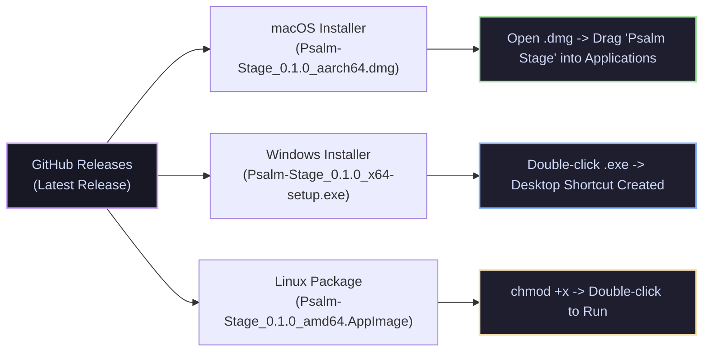

# Desktop Deployment, Packaging & Release Guide

Live worship software is used on Sunday mornings by worship pastors, audio engineers, keyboardists, and church volunteers — **not software developers**. End users must never be expected to install Node.js, Rust, or use a terminal.

This document details the automated build pipeline, installer packaging, code signing, and release workflow for distributing **Psalm Stage** as a turnkey, double-clickable desktop application.

---

## 1. End-User Download & Installation Experience

Every release publishes native, signed standalone installers to GitHub Releases:



### Platform Installer Matrix

| Operating System | Target Architecture | Installer Format | User Experience |
| :--- | :--- | :--- | :--- |
| **macOS (Apple Silicon)** | `aarch64` (M1 / M2 / M3 / M4) | `.dmg` | Standard drag-and-drop installer window |
| **macOS (Intel Core)** | `x86_64` (Intel i5/i7/i9) | `.dmg` | Standard drag-and-drop installer window |
| **Windows 10 / 11** | `x86_64` (64-bit Windows) | `.exe` (NSIS) / `.msi` | Turnkey wizard with desktop and Start Menu shortcut |
| **Linux** | `x86_64` (Ubuntu / Fedora / Arch) | `.AppImage` / `.deb` | Portable zero-install AppImage or Debian package |

---

## 2. Automated Release Pipeline (GitHub Actions)

When a version tag is pushed (e.g. `v0.1.0`), the automated GitHub Actions workflow [`.github/workflows/release.yml`](../.github/workflows/release.yml) executes across macOS, Windows, and Linux runners in parallel:

1. **Compilation**:
   - Builds optimized Angular production assets via `npm run build`.
   - Compiles pure Rust audio core and Tauri desktop harness via `cargo build --release`.
2. **Bundle Generation**:
   - Packages `.dmg` with custom window layout, application alias, and app icon.
   - Packages Windows `.exe` installer (NSIS) with uninstaller and desktop shortcut.
   - Packages Linux `.AppImage` and `.deb`.
3. **Publication**:
   - Creates a draft or public GitHub Release tagged with `vX.Y.Z`.
   - Uploads all binary installer assets with SHA-256 checksums.

### Triggering a Release
To cut a new production release for end users:
```bash
# 1. Update version in package.json and src-tauri/tauri.conf.json
npm version 0.2.0

# 2. Push tag to GitHub
git push origin --tags
```
GitHub Actions handles the rest. In ~8 minutes, all `.dmg` and `.exe` installers will be live on your project's GitHub Releases page.

---

## 3. Local Packaging (Building Installers On Your Machine)

If you need to build a `.dmg` or `.exe` installer locally on your machine without pushing to GitHub:

```bash
# Clean production build and package installer
npm run package
```

The output installer files are generated in:
```text
src-tauri/target/release/bundle/
├── dmg/
│   └── Psalm Stage_0.1.0_aarch64.dmg   # Shareable Mac installer
├── macos/
│   └── Psalm Stage.app                 # Native standalone application bundle
└── nsis/ (on Windows)
    └── Psalm Stage_0.1.0_x64-setup.exe # Shareable Windows installer
```

---

## 4. Code Signing: Do You Need an Apple Developer License?

> [!TIP] Short Answer: **NO, you do NOT need an Apple Developer license or any paid subscription!**
> You can build, package, and distribute `.dmg` and `.exe` installers **100% free of charge**. An Apple Developer Program subscription ($99/year) or Windows Authenticode certificate ($300+/year) is **completely optional**.

### 4.1 How It Works Without a Paid License (Free Open-Source Mode)

When you distribute Psalm Stage as a free open-source tool without paid developer certificates, modern operating systems display a standard one-time security prompt:

#### On macOS (Gatekeeper):
1. User downloads the `.dmg` and drags `Psalm Stage` into `Applications`.
2. On first launch, macOS says: *"macOS cannot verify the developer of Psalm Stage"* or *"App downloaded from internet"*.
3. **The 2-Second First-Time Fix**:
   * Right-click (or Control-click) `Psalm Stage` in the **Applications** folder and select **Open**.
   * Click **Open** on the confirmation dialog.
   * *(Alternatively: go to **System Settings → Privacy & Security**, scroll down, and click **"Open Anyway"**).*
4. macOS records this permission in its local quarantine database. **You only ever have to do this once.** Every subsequent launch on Sunday mornings opens instantly like any normal app!

#### On Windows (Microsoft Defender SmartScreen):
1. User runs `Psalm-Stage_0.1.0_x64-setup.exe`.
2. Windows displays: *"Windows protected your PC (Unknown Publisher)"*.
3. User clicks **"More info"** $\to$ clicks **"Run anyway"**.
4. The installer completes and creates desktop shortcuts. It never asks again.

---

### 4.2 Paid Signing (Completely Optional for Organizations)

If a church, ministry, or commercial entity chooses to purchase an Apple Developer account ($99/year) or Windows certificate to eliminate the one-time prompt entirely:

#### Optional macOS Notarization Setup:
Add these secrets to your GitHub repository under **Settings → Secrets and variables → Actions**:
* `APPLE_CERTIFICATE`: Base64-encoded Developer ID Application `.p12` certificate.
* `APPLE_CERTIFICATE_PASSWORD`: Password for the `.p12` certificate.
* `APPLE_ID`: Apple Developer account email.
* `APPLE_PASSWORD`: App-Specific Password generated on appleid.apple.com.
* `APPLE_TEAM_ID`: 10-character Apple Developer Team ID.

If these secrets are present, GitHub Actions signs the `.app` bundle, submits it to Apple's notary service via `notarytool`, and staples the notarization ticket onto the `.dmg`.
**If these secrets are not present, GitHub Actions automatically builds clean, functional unsigned `.dmg` and `.exe` installers with zero errors!**

---

## 5. Seamless In-App Auto-Updates

Psalm Stage integrates the Tauri v2 updater mechanism. When launched on a stage laptop connected to Wi-Fi, the app checks the release manifest:
1. If a newer version exists (e.g. `v0.2.0` > `v0.1.0`), a non-intrusive notification appears: *"A new version of Psalm Stage is available"*.
2. The user clicks **"Update Now"**.
3. The app downloads the binary diff, verifies the cryptographic signature, installs it in place, and restarts seamlessly.
4. If the laptop is offline (standard Sunday morning stage mode), the check silently skips with zero interruption.

