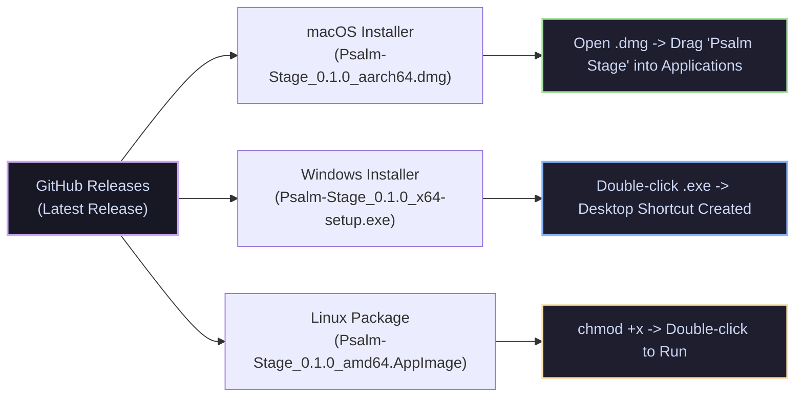

# Desktop Deployment, Packaging & Release Guide

Live worship software is used on Sunday mornings by worship pastors, audio engineers, keyboardists, and church volunteers — **not software developers**. End users must never be expected to install Node.js, Rust, or use a terminal.

This document details the automated build pipeline, installer packaging, code signing, and release workflow for distributing **Psalm Stage** as a turnkey, double-clickable desktop application.

---

## 1. End-User Download & Installation Experience

Every release publishes native, signed standalone installers to GitHub Releases:



### Platform Installer Matrix

| Operating System | Target Architecture | Installer Format | User Experience |
| :--- | :--- | :--- | :--- |
| **macOS (Apple Silicon)** | `aarch64` (M1 / M2 / M3 / M4) | `.dmg` | Standard drag-and-drop installer window |
| **macOS (Intel Core)** | `x86_64` (Intel i5/i7/i9) | `.dmg` | Standard drag-and-drop installer window |
| **Windows 10 / 11** | `x86_64` (64-bit Windows) | `.exe` (NSIS) / `.msi` | Turnkey wizard with desktop and Start Menu shortcut |
| **Linux** | `x86_64` (Ubuntu / Fedora / Arch) | `.AppImage` / `.deb` | Portable zero-install AppImage or Debian package |

---

## 2. Automated Release Pipeline (GitHub Actions)

When a version tag is pushed (e.g. `v0.1.0`), the automated GitHub Actions workflow [`.github/workflows/release.yml`](../.github/workflows/release.yml) executes across macOS, Windows, and Linux runners in parallel:

1. **Compilation**:
   - Builds optimized Angular production assets via `npm run build`.
   - Compiles pure Rust audio core and Tauri desktop harness via `cargo build --release`.
2. **Bundle Generation**:
   - Packages `.dmg` with custom window layout, application alias, and app icon.
   - Packages Windows `.exe` installer (NSIS) with uninstaller and desktop shortcut.
   - Packages Linux `.AppImage` and `.deb`.
3. **Publication**:
   - Creates a draft or public GitHub Release tagged with `vX.Y.Z`.
   - Uploads all binary installer assets with SHA-256 checksums.

### Triggering a Release
To cut a new production release for end users:
```bash
# 1. Update version in package.json and src-tauri/tauri.conf.json
npm version 0.2.0

# 2. Push tag to GitHub
git push origin --tags
```
GitHub Actions handles the rest. In ~8 minutes, all `.dmg` and `.exe` installers will be live on your project's GitHub Releases page.

---

## 3. Local Packaging (Building Installers On Your Machine)

If you need to build a `.dmg` or `.exe` installer locally on your machine without pushing to GitHub:

```bash
# Clean production build and package installer
npm run package
```

The output installer files are generated in:
```text
src-tauri/target/release/bundle/
├── dmg/
│   └── Psalm Stage_0.1.0_aarch64.dmg   # Shareable Mac installer
├── macos/
│   └── Psalm Stage.app                 # Native standalone application bundle
└── nsis/ (on Windows)
    └── Psalm Stage_0.1.0_x64-setup.exe # Shareable Windows installer
```

---

## 4. Code Signing & macOS Gatekeeper: The Quarantine Flag

> [!IMPORTANT] You do NOT need an Apple Developer license or any paid subscription!
> You can build, package, and distribute `.dmg`, `.pkg`, and `.exe` installers **100% free of charge**. An Apple Developer Program subscription ($99/year) is **completely optional**.

### 4.1 Understanding the "Flag": `com.apple.quarantine`

Why does macOS Gatekeeper block apps downloaded from the web?
When any browser (Safari, Chrome, Firefox) downloads an archive or installer, macOS automatically attaches an extended filesystem attribute known as the **quarantine flag**:
```bash
com.apple.quarantine
```
Gatekeeper **only** assesses notarization on binaries that have this quarantine flag attached. If the flag is removed, macOS treats the binary as locally created and allows immediate launch.

### 4.2 The macOS 15 Sequoia Gatekeeper Changes

In previous macOS versions (Sonoma and earlier), users could Control-click (or right-click) an unnotarized app and select **Open** to bypass Gatekeeper.

**In macOS 15 Sequoia, Apple removed the right-click "Open" bypass entirely.** Control-clicking now only shows "Move to Trash" or "Cancel".

### 4.3 Three Seamless Installation Methods for macOS Users (No Apple License Needed)

To deliver a completely seamless experience on macOS Sequoia without paying Apple, Psalm Stage supports three methods:

#### Method 1: The Automated 1-Line Installer Script (Most Seamless)
Non-developer users can simply copy and paste this single command into Terminal (Spotlight $\to$ Terminal):
```bash
curl -fsSL https://raw.githubusercontent.com/dayo-a/psalm-stage/main/install.sh | bash
```
**What this does automatically in 5 seconds:**
1. Detects Apple Silicon (`aarch64`) vs Intel (`x86_64`).
2. Downloads the latest release `.dmg` from GitHub.
3. Installs `Psalm Stage.app` directly into `/Applications/`.
4. Automatically strips the `com.apple.quarantine` attribute.
5. Launches Psalm Stage immediately with **zero Gatekeeper prompts**.

#### Method 2: The Standalone `.pkg` Apple Installer
We provide a standard Apple `.pkg` installer alongside the `.dmg`:
* Inside the `.pkg`, a lightweight `scripts/postinstall` hook runs automatically:
  ```bash
  xattr -cr "/Applications/Psalm Stage.app" 2>/dev/null || true
  ```
* Because the `.pkg` runs locally, the post-install hook clears the quarantine flag during installation, allowing double-click launch from Applications.

#### Method 3: The Official macOS Sequoia System Settings Pathway (For `.dmg` Downloads)
If a user prefers downloading the `.dmg` manually:
1. Drag **Psalm Stage** into `/Applications`.
2. Double-click the app. macOS Sequoia will show: *"Psalm Stage cannot be opened because it is from an unidentified developer"*. Click **Done**.
3. Open **System Settings → Privacy & Security**.
4. Scroll down to the **Security** section.
5. Click the **"Open Anyway"** button next to *"Psalm Stage was blocked from use"*.
6. Enter Touch ID or Mac password, and click **Open**.
7. macOS remembers this permanently. You never have to do it again!

*(Alternatively, run `xattr -cr "/Applications/Psalm Stage.app"` once in Terminal to instantly strip the flag).*

---

### 4.4 Windows Defender SmartScreen

On Windows 10/11:
1. User runs `Psalm-Stage_0.1.0_x64-setup.exe`.
2. Windows Defender SmartScreen may display: *"Windows protected your PC (Unknown Publisher)"*.
3. User clicks **"More info"** $\to$ clicks **"Run anyway"**.
4. The installer completes and creates desktop shortcuts. It never asks again.

---

### 4.5 Paid Signing (Completely Optional for Large Churches or Enterprises)

If a church or organization chooses to purchase an Apple Developer account ($99/year) to eliminate the "Open Anyway" step:
Configure these GitHub Secrets in your repository:
* `APPLE_CERTIFICATE`: Base64-encoded Developer ID Application `.p12` certificate.
* `APPLE_CERTIFICATE_PASSWORD`: Password for the `.p12` certificate.
* `APPLE_ID`: Apple Developer account email.
* `APPLE_PASSWORD`: App-Specific Password generated on appleid.apple.com.
* `APPLE_TEAM_ID`: 10-character Apple Developer Team ID.

When present, `tauri-action` automatically signs and notarizes the `.app` bundle via `notarytool`. When absent, it builds clean, free installers.

---

## 5. Seamless In-App Auto-Updates

Psalm Stage integrates the Tauri v2 updater mechanism. When launched on a stage laptop connected to Wi-Fi, the app checks the release manifest:
1. If a newer version exists (e.g. `v0.2.0` > `v0.1.0`), a non-intrusive notification appears: *"A new version of Psalm Stage is available"*.
2. The user clicks **"Update Now"**.
3. The app downloads the binary diff, verifies the cryptographic signature, installs it in place, and restarts seamlessly.
4. If the laptop is offline (standard Sunday morning stage mode), the check silently skips with zero interruption.

