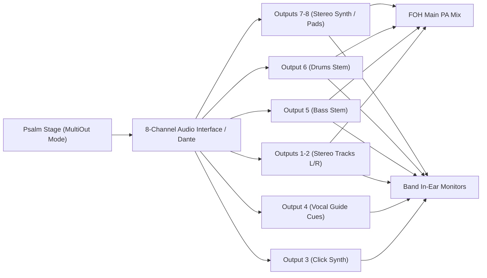

# Stage Hardware Wiring & Audio Routing Guide

This guide covers physical cabling, audio interface selection, stage direct boxes (DI), and digital mixer channel assignments for running multitracks with Psalm Stage in live worship environments.

---

## 1. Setup A: The 2-Channel "Split L/R" Setup (Universal Standard)

The vast majority of church worship teams utilize an affordable 2-channel USB audio interface (e.g., Focusrite Scarlett Solo / 2i2, Behringer U-Phoria UMC202HD / UMC204HD, PreSonus AudioBox USB 96, MOTU M2 / M4, Universal Audio Volt, SSL 2, Zoom UAC-2).

In this configuration, stereo separation is traded for complete electrical isolation between what the auditorium audience hears (Front of House) and what the band hears (In-Ear Monitors).

### 1.1 Physical Cabling Diagram

```text
[ Stage Laptop running Psalm Stage ]
       │ (USB-C)
       ▼
[ Standard 2-Output Audio Interface (Focusrite / Behringer / PreSonus / MOTU) ]
       ├── Output 1 (Left 1/4" TRS)  ──► [ Passive DI Box Channel 1 ] ──► XLR ──► Snake Ch 1 (Tracks - FOH & IEMs)
       └── Output 2 (Right 1/4" TRS) ──► [ Passive DI Box Channel 2 ] ──► XLR ──► Snake Ch 2 (Click/Cues - IEMs ONLY!)
```

### 1.2 Digital Console (Mixer) Configuration

| Mixer Channel | Source | FOH Main LR Routing | Band IEM Aux Busses | Processing / Preamp |
| :--- | :--- | :--- | :--- | :--- |
| **Channel 1** | Tracks (Music Stems) | **ASSIGNED (ON)** | Assigned to all band mixes | Flat EQ, High-Pass filter at $30\text{ Hz}$ |
| **Channel 2** | Click & Guide Cues | **UNASSIGNED / MUTED!** | Assigned to IEM mixes only | High-Pass at $100\text{ Hz}$, gentle compressor |

> [!CAUTION] Critical Verification Checklist
> 1. **Direct Monitor OFF**: On your audio interface (Focusrite, Behringer, PreSonus, etc.), verify that the **Direct Monitor** hardware button/switch is set to **OFF**. If left ON, the click track will leak directly into your monitor outputs.
> 2. **Disable macOS Mono Audio**: On macOS, navigate to **System Settings $\to$ Accessibility $\to$ Audio** and verify that **"Play stereo audio as mono"** is **DISABLED**. If enabled, macOS sums the Left and Right channels before sending them to the interface, leaking the click directly into the House PA!
> 3. **FOH Unassign**: Before unmuting the mixer, push up Channel 2 with Channel 1 down, and verify complete silence in the auditorium main PA speakers.

---

## 2. Setup B: Multi-Channel Stage Interface (4 to 16 Channels)

For larger worship teams using multi-output USB or Thunderbolt interfaces (e.g., Focusrite Scarlett 18i20, MOTU Ultralite, Behringer X32 / M32 USB card, or Dante Virtual Soundcard):



### Benefits of Multi-Channel Routing:
- FOH Sound Engineer has direct control over the bass guitar fader and kick/snare level without asking the worship leader to modify laptop stem levels.
- Click and Vocal Guide Cues are on separate console faders, allowing individual band members (e.g. drummer vs lead vocalist) to balance click vs cues independently.
- Full stereo image preservation for synthesizers, stereo guitars, and ambient pads.

---

## 3. Direct Box (DI) Selection & Ground Loops

Laptops connected to stage wall power (AC chargers) frequently generate $60\text{ Hz}$ or $50\text{ Hz}$ ground hum over audio lines.

- **Use Passive DI Boxes with Transformers**: Always use passive direct boxes equipped with isolation transformers (e.g., Radial ProDI, Radial ProD2, Whirlwind Director, or Behringer Ultra-DI DI20).
- **Ground Lift Switch**: If you hear a buzz or hum in the monitors, toggle the `GND LIFT` switch on the DI box to isolate laptop ground from stage console ground.
- **Always Keep Laptop Plugged In**: Never run a live church service on laptop battery power alone. Operating systems aggressively throttle CPU clock speeds on battery, causing buffer underruns and audio dropouts.

