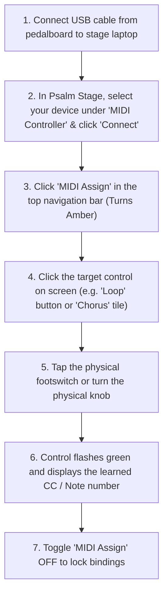

# Hardware MIDI Stage Mapping & Controller Guide

This guide explains how to connect, configure, and operate hardware MIDI controllers and footswitches with Psalm Stage for hands-free stage performance.

---

## 1. Supported Stage Hardware

Psalm Stage supports all class-compliant USB and 5-pin DIN MIDI hardware natively across macOS, Windows, and Linux without requiring proprietary drivers:

| Hardware Type | Popular Stage Models | Primary Use Case |
| :--- | :--- | :--- |
| **MIDI Keyboards & Synths** | M-Audio Oxygen / Keystation, Arturia KeyLab / Minilab, Novation Launchkey, Native Instruments Komplete Kontrol, Roland, Yamaha, Nektar | Keys player playing notes, triggering pads, moving faders, pitch/mod wheels, transport buttons |
| **Dedicated Footswitches** | Morningstar MC3 / MC6 / MC8, Hotone Ampero Control, Behringer FCB1010 | Worship leader floor foot control for Play, Stop, Loop, Section jumps |
| **Guitar Multi-Effects** | Line 6 Helix / HX Stomp, Neural DSP Quad Cortex, Fractal FM3 | Multi-duty: Guitar tone switching + sending USB MIDI commands to Psalm Stage |
| **Desktop Fader Banks** | Korg nanoKONTROL 2, Akai MIDImix, Novation Launch Control XL | Sound engineer or drummer mixing stem levels, click volume, and master gain |

---

## 2. Zero-Config Auto-Connect & Omni Mode

Psalm Stage features **Universal Omni Input**:
* **Plug and Play**: When Psalm Stage launches, it automatically scans all available CoreMIDI / ALSA / WinMM ports and connects to them in **Omni Mode**.
* **Multi-Port Keyboard Support**: Keyboards with multiple virtual ports (such as the M-Audio Oxygen 49 MKV, which exposes Keyboard, DAW, and Editor ports) are unified, ensuring all musical keys, velocity pads, and faders transmit seamlessly.
* **Background Hotplug Monitoring**: If you plug in your USB keyboard or pedalboard *after* the app is already open, a background scanner detects the device within 1.5 seconds and connects automatically without requiring an app restart.
* **Live Visual Feedback**: Whenever any key is played or footswitch tapped, the active MIDI monitor flashes green and displays the decoded note name (e.g. `Note C4 (60)`), velocity, and channel.

---

## 2. Recommended Footswitch Stage Layout (6-Switch Example)

For a standard 6-button stage pedalboard (such as a Morningstar MC6 or Hotone Ampero Control + 2 aux switches), the following layout is battle-tested in live worship services:

```text
┌──────────────────────┬──────────────────────┬──────────────────────┐
│       [ Switch A ]   │       [ Switch B ]   │       [ Switch C ]   │
│       PREV SECTION   │       INFINITE LOOP  │       NEXT SECTION   │
│       (CC 10)        │       (CC 11 / 'L')  │       (CC 12)        │
├──────────────────────┼──────────────────────┼──────────────────────┤
│       [ Switch D ]   │       [ Switch E ]   │       [ Switch F ]   │
│       PLAY / STOP    │       CHORUS JUMP    │       BRIDGE JUMP    │
│       (CC 13 / Space)│       (CC 14)        │       (CC 15)        │
└──────────────────────┴──────────────────────┴──────────────────────┘
```

### Action Logic:
- **Switch D (`Play / Stop`)**: Starts playback or stops gracefully.
- **Switch B (`Infinite Loop`)**: Tapping this immediately arms the active section to loop seamlessly when it reaches the end bar, letting the worship leader extend ministry or prayer times without taking hands off an instrument.
- **Switch C (`Next Section`)**: Quantized jump to the following section at the next bar boundary.
- **Switch E & F (`Chorus / Bridge`)**: Direct jumps straight to dynamic song peaks when following the Holy Spirit spontaneously.

---

## 3. Step-by-Step MIDI Learn Workflow

Binding controls takes only seconds and requires zero programming:



---

## 4. MIDI Message Types & Trigger Behaviors

### 4.1 Message Types:
- **Control Change (CC)**: Recommended for footswitches and continuous faders. Sends a Controller number ($0\text{ to }127$) and Value ($0\text{ to }127$).
- **Note On / Off**: Standard keyboard notes and drum pads.
- **Program Change (PC)**: Patch selection messages commonly sent by multi-effects modelers.

### 4.2 Trigger Behaviors:
- **Momentary (`MidiTriggerBehavior::Momentary`)**: Triggers an action only when the button is pressed down ($\text{value} > 0$). Safe for Play/Stop and Section Jumps.
- **Toggle (`MidiTriggerBehavior::Toggle`)**: Switches an on/off state every time a value $> 64$ is received. Ideal for Loop Toggle and Mute buttons.
- **Continuous (`MidiTriggerBehavior::Continuous`)**: Maps $0\text{ to }127$ across an analog curve ($0.0\text{ to }1.0$) for faders, click level, and master gain.

---

## 5. Local Profile Storage & Multi-User Portability

All MIDI bindings are saved in a machine-local profile file:
```text
~/.psalm-stage/midi-profile.json
```
Because the MIDI mappings are stored on the local machine rather than inside church song folders, multiple musicians can connect their own personal pedalboards without modifying the church's shared song library or disturbing other leaders' settings.

