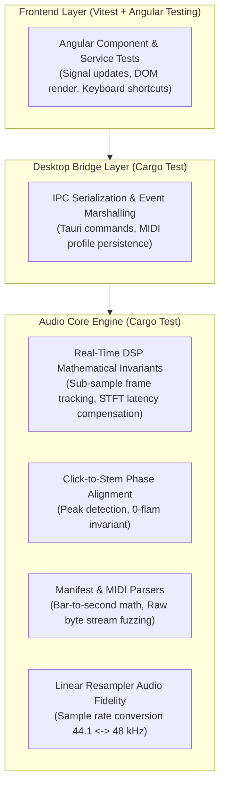

# Quality Assurance & Testing Strategy: Psalm Stage

In mission-critical live stage software, quality is not optional. A failure on a Sunday morning or at a live conference affects thousands of people.

Psalm Stage enforces a multi-tiered testing strategy spanning pure Rust unit tests, DSP latency assertions without physical sound cards, and zoneless Angular UI unit tests.

---

## 1. Testing Pyramid



---

## 2. DSP & Audio Engine Testing Without Audio Hardware

One of the key engineering achievements in `crates/psalm-audio-core` is complete testability without requiring a physical audio interface or OS audio server.

The internal DSP loop in `Engine::render_block(&mut self, frames: usize) -> (Vec<f32>, Vec<f32>)` can be called directly by unit tests, rendering pure deterministic audio blocks into test vectors:

### 2.1 The Latency Compensation Test (`test_sync_bypass_playback`)
- **Objective**: Ensure that in native bypass playback, the click impulse and stem downbeat peak emerge at the exact same buffer index.
- **Assertion**:
  $$\text{Peak}_{\text{click}} = \text{Peak}_{\text{stem}} = \text{Index } 0$$

### 2.2 The Time-Stretch Latency Compensation Test (`test_sync_between_music_and_click_with_tempo_change`)
- **Objective**: When tempo is stretched to 90 BPM or 60 BPM (engaging the STFT phase vocoder with $5{,}760\text{ samples}$ delay), ensure the delayed click impulse precisely matches the vocoder output downbeat.
- **Assertion**:
  $$|\text{Index}_{\text{click}} - \text{Index}_{\text{stem}}| \le 2\text{ frames}$$

### 2.3 Sub-Sample Float Drift Test
- **Objective**: Simulate 10,000 blocks at 80 BPM (non-integer tempo ratio $\frac{80}{72} = 1.1111...$).
- **Assertion**: Cumulative frame advancement must match $(N_{\text{blocks}} \times \text{block\_size} \times \text{ratio})$ to within $< 10^{-5}$ frames.

---

## 3. Running the Test Suites

### 3.1 Rust Workspace Test Suite
Runs all audio core unit tests, manifest validators, MIDI decoders, and resamplers:
```bash
cargo test --workspace
```

### 3.2 Angular Frontend Test Suite
Runs Vitest unit tests for the Angular stage UI, services, and Spartan-ng components:
```bash
export PATH=/opt/homebrew/bin:$PATH
npx ng test --watch=false
```

### 3.3 Production Bundle Verification
Verifies that the Angular application compiles cleanly with zero TypeScript errors and generates optimized production assets:
```bash
export PATH=/opt/homebrew/bin:$PATH
npm run build
```

---

## 4. Continuous Integration (CI) Invariants

Before any pull request is merged into `main`:
1. `cargo test --workspace` must exit with code 0 (100% pass).
2. `cargo clippy --workspace -- -D warnings` must produce zero warnings.
3. `npx ng test --watch=false` must pass with 0 failures.
4. `npm run build` must generate valid production bundles.

