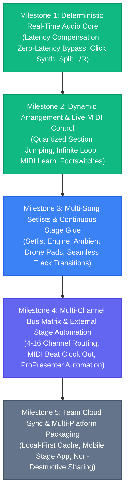

# OpenSpec Feature Pipeline: Psalm Stage

Welcome to the **Psalm Stage OpenSpec Feature Pipeline**. This document outlines the architectural roadmap, technical specifications, implementation phases, and test coverage invariants for building a professional, ultra-reliable, open-source live worship stage playback and controller system.

---

## 1. Vision & Core Principles

Live stage playback software operates in a high-stakes, mission-critical environment: Sunday morning services, conferences, and live worship sets. A glitch, audio dropout, or sync drift can disrupt an entire congregation.

Psalm Stage is engineered around four core tenets:

1. **Zero-Latency Invariant & Bit-Perfect Streaming**:
   When playing back at native BPM and pitch (0 semitones shift), the audio engine completely bypasses all spectral phase-vocoder processing. This guarantees zero-latency, transient-preserving, bit-perfect playback with identical phase coherence.
2. **Deterministic Timekeeping & Latency Compensation**:
   When time stretching or pitch shifting is active, the STFT phase vocoder introduces algorithmic group delay ($5{,}760$ samples / $120\text{ ms}$ at $48\text{ kHz}$). The synthesized metronome (click) and cue engine dynamically delay their impulse trains by the exact stretcher latency frame-for-frame, preventing flams against stems.
3. **Stage-Safe Operation (Fail-Safe Live Lock)**:
   Any UI interaction or accidental keyboard touch that could destroy or stop a live service (closing the app, deleting tracks, dragging files, losing audio focus) is locked out during playback.
4. **Hardware Agnosticism & Universal MIDI**:
   Native support for cost-effective 2-output stage interfaces (Focusrite Scarlett Solo/2i2 Split L/R) through 16+ channel Dante/USB stage boxes, paired with universal MIDI learn for stage footswitches (Morningstar, Line 6, Hotone, Behringer).

---

## 2. OpenSpec Specification Index

Each specification defines requirements, exact data contracts, audio engine invariants, edge-case state machines, and automated test requirements.

| Spec ID | Title | Domain | Priority | Implementation Status | Test Coverage |
| :--- | :--- | :--- | :--- | :--- | :--- |
| [**SPEC-001**](./specs/SPEC-001-AUDIO-ENGINE.md) | Real-Time DSP Audio Engine & Time/Pitch Stretcher | Audio Core / DSP | P0 (Critical) | **Implemented** | Unit & Invariant Tests Passing |
| [**SPEC-002**](./specs/SPEC-002-CLICK-AND-ROUTING.md) | Synthesized Metronome, Cue Bus & Audio Output Matrix | Routing / IEM | P0 (Critical) | **Implemented** | Sub-Sample Timing Verified |
| [**SPEC-003**](./specs/SPEC-003-ARRANGEMENT-QUANTIZATION.md) | Section Markers, Quantized Jumping & Infinite Looping | Arrangement | P0 (Critical) | **Implemented** | Bar Math & Jump Tests Passing |
| [**SPEC-004**](./specs/SPEC-004-SETLIST-FLOW.md) | Multi-Song Setlist Engine & Seamless Flow Modes | Live Flow | P1 (High) | **Specification Ready** | Manifest Schema Validated |
| [**SPEC-005**](./specs/SPEC-005-MIDI-STAGE-CONTROL.md) | Hardware MIDI Stage Control, MIDI Learn & Live Lock | Hardware Control | P1 (High) | **Implemented (Core)** | Parser & Binding Tests Passing |
| [**SPEC-006**](./specs/SPEC-006-LIBRARY-BUNDLE-SYSTEM.md) | Song Bundle Packaging, Manifest Schema & Stem Decoder | Library / IO | P1 (High) | **Implemented** | Resampler & Codec Tests Passing |
| [**SPEC-007**](./specs/SPEC-007-CONTINUOUS-PADS.md) | Ambient Drone Pad Engine & Cross-Key Stage Glue | Sound Design | P2 (Medium) | **Planned** | Synthetic Drone Test Pending |
| [**SPEC-008**](./specs/SPEC-008-STAGE-UI-SPARTAN.md) | High-Contrast Stage UI, Tailwind v4 & Spartan-ng | Frontend UI | P1 (High) | **Implemented (Core)** | Angular Vitest Passing |
| [**SPEC-009**](./specs/SPEC-009-MIDI-CLOCK-AUTOMATION.md) | Outbound MIDI Beat Clock & ProPresenter / Rig Sync | External Sync | P2 (Medium) | **Planned** | Clock Jitter Spec Defined |
| [**SPEC-010**](./specs/SPEC-010-CLOUD-SYNC-OFFLINE.md) | Local-First Offline Caching & Non-Destructive Overrides | Cloud / Collab | P3 (Low) | **Backlog** | Model Spec Defined |

---

## 3. Implementation Milestones

### Milestone 1: Deterministic Real-Time Audio Core (Done)
- Pure Rust real-time audio thread running lock-free via `rtrb` bounded ringbuffers.
- Algorithmic latency compensation ($5{,}760$ samples) aligning synthesized metronome and audio stems.
- Continuous fractional sample position tracking without truncation drift.
- Dual-channel Split L/R output matrix for Focusrite Scarlett / stage audio interfaces.

### Milestone 2: Dynamic Arrangement & Live Stage Control (Done)
- Section definitions with bar-accurate quantization (Next Bar, End of Section).
- Seamless Infinite Section Looping with crossfade boundaries.
- Flexible MIDI Learn architecture supporting Note, Control Change (CC), and Program Change (PC).
- Spartan-ng (`vega`) high-contrast stage view for low-light platform visibility.

### Milestone 3: Multi-Song Setlists & Continuous Stage Glue (Active)
- Setlist sequence model supporting song order, duplicate songs with transpositions, and tempo overrides.
- Ambient drone pad synthesis across all 12 musical keys with cross-key 4-second equal-power crossfades.
- Playback flow modes: Auto-Advance, Auto-Pause (wait for leader count-in), and Manual Trigger.

### Milestone 4: Multi-Channel Matrix & External Automation (Next)
- 4, 8, and 16-channel physical routing matrix (e.g., Output 1-2 Tracks, 3 Click, 4 Cues, 5 Bass, 6 Drums, 7-8 Synths).
- Outbound MIDI Beat Clock transmission over USB/DIN to sync hardware delay pedals (Strymon, Eventide).
- MIDI cue automation track sending Program Changes to amp modelers (Kemper, Helix, Quad Cortex) and lyric projection software.

### Milestone 5: Collaborative Cloud Library & Ecosystem (Future)
- Church team song synchronization with local-first offline caching.
- Non-destructive worship leader arrangement overrides (arrangement templates per service).
- Multi-platform stage monitor app running on iOS/Android via Tauri mobile.

---

## 4. Quality & Verification Standards

To guarantee enterprise-grade stability on stage, all features must meet these rigorous test criteria prior to merging:

1. **Audio Real-Time Invariant**:
   The audio callback thread must never allocate memory (`malloc` / `Box::new`), acquire blocking mutexes, perform file I/O, or perform unbounded system calls.
2. **DSP Determinism & Latency Proof**:
   Unit tests must simulate audio blocks across sample rates ($44.1\text{ kHz}$, $48\text{ kHz}$, $96\text{ kHz}$) and verify pulse intervals, phase vocoder latency matching, and sub-sample mathematical accuracy without physical hardware dependencies.
3. **Frontend Reactivity & Isolation**:
   Angular components must maintain high framerate ($60\text{ fps}$) rendering with zoneless change detection (`signal()`), decoupling high-frequency audio telemetry from the main DOM renderer.
4. **CI Matrix Testing**:
   Continuous integration runs `cargo test --workspace`, `npx ng test --watch=false`, and `npm run build` across macOS, Linux, and Windows runners.

