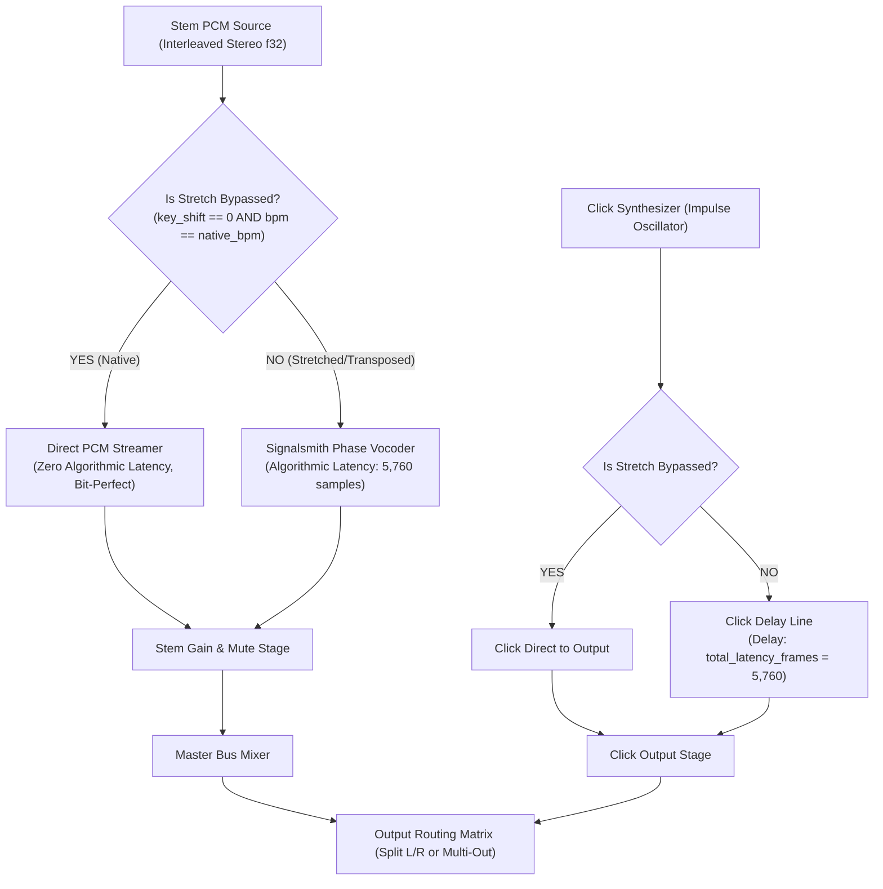

# SPEC-001: Real-Time DSP Audio Engine & Time/Pitch Stretcher

| Metadata | Value |
| :--- | :--- |
| **Spec ID** | `SPEC-001` |
| **Title** | Real-Time DSP Audio Engine & Time/Pitch Stretcher |
| **Module** | `crates/psalm-audio-core/src/engine.rs`, `stretcher.rs` |
| **Status** | Implemented & Verified |
| **Priority** | P0 (Critical) |
| **Related Specs** | [SPEC-002: Click & Routing](./SPEC-002-CLICK-AND-ROUTING.md), [SPEC-003: Arrangement & Quantization](./SPEC-003-ARRANGEMENT-QUANTIZATION.md) |

---

## 1. Overview & Problem Statement

Live worship multitrack playback requires two simultaneous capabilities that are frequently in tension:
1. **Pristine, Transient-Accurate Native Playback**: When playing at the recorded tempo and key, tracks must sound punchy, transparent, and phase-coherent, with zero latency and zero computational degradation.
2. **Dynamic Live Time Stretching & Transposition**: When a worship leader adjusts the song tempo (e.g. from 72 BPM to 76 BPM) or key (e.g. from G to Bb for a female lead vocal), stems must smoothly stretch and pitch-shift in real time without glitching or pitch drifting.

Historically, passing audio through STFT (Short-Time Fourier Transform) phase vocoders introduces significant algorithmic group delay ($5{,}760$ samples / $120\text{ ms}$ at $48\text{ kHz}$). If the synthesized metronome (click) is rendered at frame zero while the audio is delayed by $120\text{ ms}$, the metronome fires ahead of the backing tracks, causing a severe flam.

---

## 2. Architectural Design & Invariants

### 2.1 The Two-Mode Pipeline Architecture

The audio core implements an adaptive dual-path architecture:



### 2.2 Invariant Equations

1. **Zero-Latency Bypass**:
   $$\text{Bypass Condition} \iff (\Delta k = 0) \land (|B_{\text{target}} - B_{\text{native}}| < 10^{-6})$$
   When active, latency across the stem pipeline $\tau_{\text{stem}} = 0\text{ samples}$.

2. **Latency-Compensated Click Alignment**:
   When $\text{Bypass Condition}$ is false:
   $$\tau_{\text{stretcher}} = \text{input\_latency} + \text{output\_latency} = 2{,}880 + 2{,}880 = 5{,}760\text{ samples} \quad (@ 48\text{ kHz})$$
   $$\tau_{\text{click\_delay}} = \tau_{\text{stretcher}} \implies \Delta t_{\text{sync}} = |\tau_{\text{stem\_output}} - \tau_{\text{click\_output}}| = 0\text{ samples}$$

3. **Sub-Sample Cursor Tracking (Anti-Drift)**:
   Frame advancement in the audio callback must accumulate exact floating-point sub-sample increments:
   $$\text{source\_frame\_pos}_{n+1} = \text{source\_frame\_pos}_n + (N_{\text{frames}} \cdot \text{playback\_rate})$$
   Truncating or flooring `source_frame_pos` at buffer boundaries produces cumulative drift ($> 62\text{ samples}$ per second), which destroys tight click-to-kick locking.

---

## 3. Data Contracts & Structures

```rust
pub struct EngineSnapshot {
    pub song_id: Option<String>,
    pub song_title: String,
    pub original_key: String,
    pub current_key: String,
    pub is_playing: bool,
    pub current_bar: u32,
    pub current_beat: u32,
    pub beats_per_bar: u32,
    pub active_section_id: Option<String>,
    pub armed_section_id: Option<String>,
    pub loop_enabled: bool,
    pub quantize_mode: QuantizeMode,
    pub key_shift_semitones: i32,
    pub base_bpm: f64,
    pub current_bpm: f64,
    pub master_gain: f32,
    pub click_gain: f32,
    pub click_muted: bool,
    pub routing_mode: OutputRoutingMode,
    pub device_name: String,
    pub device_sample_rate: u32,
    pub device_channels: u16,
    pub sections: Vec<SectionSnapshot>,
    pub stems: Vec<StemSnapshot>,
}
```

---

## 4. Verification & Testing Strategy

To ensure zero regressions, tests in `crates/psalm-audio-core/src/engine.rs` must verify:
- **`test_sync_bypass_playback`**: Asserts that in native mode, the stem output and click output register simultaneous downbeat peaks at the exact same buffer index.
- **`test_sync_between_music_and_click_with_tempo_change`**: Asserts that when stretched to 90 BPM or 60 BPM, the delay-compensated click aligns with the vocoder output to within $\pm 2$ frames.
- **`test_stretcher_latency`**: Asserts that `SignalsmithStretch::total_latency_frames()` returns precisely the expected algorithmic delay for $44.1\text{ kHz}$, $48\text{ kHz}$, and $96\text{ kHz}$.
