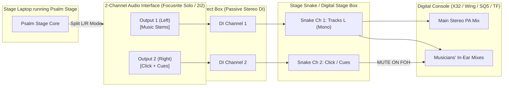

# SPEC-002: Synthesized Metronome, Cue Bus & Audio Output Matrix

| Metadata | Value |
| :--- | :--- |
| **Spec ID** | `SPEC-002` |
| **Title** | Synthesized Metronome, Cue Bus & Audio Output Matrix |
| **Module** | `crates/psalm-audio-core/src/click.rs`, `routing.rs` |
| **Status** | Implemented & Verified |
| **Priority** | P0 (Critical) |
| **Related Specs** | [SPEC-001: Audio Engine](./SPEC-001-AUDIO-ENGINE.md), [SPEC-005: MIDI Stage Control](./SPEC-005-MIDI-STAGE-CONTROL.md) |

---

## 1. Overview & Stage Requirements

In a live stage environment, audio distribution must strictly separate:
1. **Front-of-House (FOH) PA Audio**: Only musical stems (drums, bass, guitars, keys, pads, background vocals). Front-of-House must **never** receive the click track or vocal guide cues.
2. **In-Ear Monitor (IEM) / Musician Audio**: Requires a high-clarity click track, accented downbeats, verbal section cues ("Intro, 2, 3, 4", "Chorus in 2, 3, 4"), and the musical stems.

Most worship teams start with widely available 2-channel USB audio interfaces (such as a Focusrite Scarlett Solo or 2i2). More established teams utilize 4 to 16-channel stage interfaces or Dante networks. Psalm Stage must support both workflows transparently.

---

## 2. Audio Output Routing Modes

```rust
#[derive(Debug, Clone, Copy, PartialEq, Eq, Serialize, Deserialize)]
pub enum OutputRoutingMode {
    /// 2-output interface mode (e.g. Focusrite Scarlett Solo / 2i2):
    /// Channel 1 (Left)  = Mono Musical Stems (Sent to FOH + IEMs)
    /// Channel 2 (Right) = Click + Vocal Cues (Sent to IEMs ONLY, NEVER to FOH)
    SplitLeftRight,

    /// Reversed 2-output mode for legacy console patches:
    /// Channel 1 (Left)  = Click + Cues
    /// Channel 2 (Right) = Music
    SplitClickLeftMusicRight,

    /// 4+ output interface mode:
    /// Channels 1-2 = Stereo Musical Stems (FOH Left / Right)
    /// Channels 3-4 = Stereo Click & Vocal Cues (IEM Bus)
    MultiOutStereo,
}
```

### 2.1 The Split L/R Wiring Scheme (Focusrite 2-Output)



> [!WARNING] Critical Stage Setup Safety
> On any 2-channel interface using `SplitLeftRight`:
> 1. Ensure **Direct Monitor** hardware switch on the interface is set to **OFF**.
> 2. Ensure macOS **System Settings → Accessibility → Audio → "Play stereo audio as mono"** is **OFF**.
> 3. Verify on the stage mixing console that the Click/Cue channel is unassigned from the Main Stereo FOH bus!

---

## 3. Synthesized Click Engine Architecture

Rather than relying on sampled WAV audio files that can suffer from disk buffering delays or phase discrepancies when pitched, Psalm Stage generates click tones using an internal real-time impulse synthesis oscillator (`ClickSynth`).

### 3.1 Synthesis Algorithm

The click produces high-impact, piercing transient clicks with zero DC offset and exponential decay:
- **Downbeat (Beat 1)**: $1{,}600\text{ Hz}$ sine burst, $12\text{ ms}$ decay time.
- **Subsequent Beats (Beats 2, 3, 4...)**: $800\text{ Hz}$ sine burst, $10\text{ ms}$ decay time.
- **Formula**:
  $$s(t) = \sin(2\pi f t) \cdot e^{-\lambda t}$$
  where $\lambda = \frac{5}{\tau_{\text{decay}}}$.

### 3.2 Dynamic Delay Compensation (`ClickDelayBuffer`)

When dynamic time stretching or pitch shifting is active on the stems, the phase vocoder induces a deterministic delay $\Delta = 5{,}760\text{ frames}$.
The `ClickDelayBuffer` maintains a circular ringbuffer of length $\Delta$:
$$y[n] = x[n - \Delta]$$
When the engine switches back to native bypass ($0\text{ semitones}$, native BPM), the delay line transitions smoothly to $\Delta = 0$ at the next bar boundary.

---

## 4. Verification & Testing

The click module includes automated tests in `crates/psalm-audio-core/src/click.rs`:
- **`test_click_synth_trigger_and_decay`**: Verifies that triggered clicks reach peak amplitude within 1 frame and decay exponentially below $-60\text{ dBFS}$ within $15\text{ ms}$.
- **`test_click_delay_buffer_exact_delay`**: Verifies that an input impulse placed at index $k$ emerges at exactly index $k + \Delta$ with 0 phase distortion.
