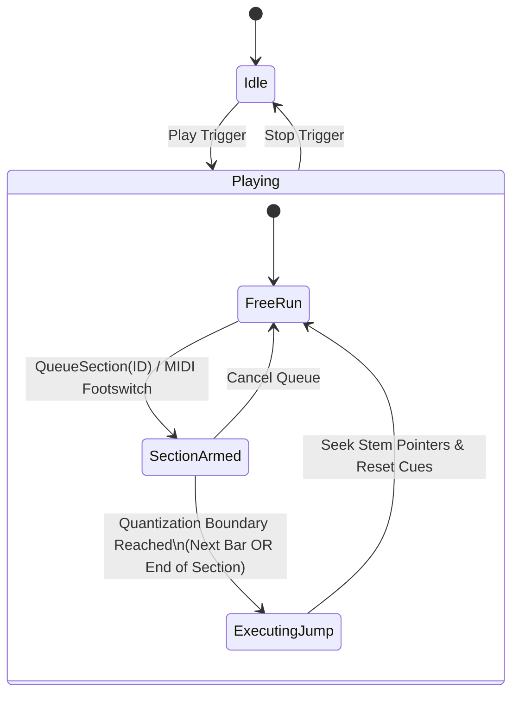

# SPEC-003: Section Markers, Quantized Jumping & Infinite Looping

| Metadata | Value |
| :--- | :--- |
| **Spec ID** | `SPEC-003` |
| **Title** | Section Markers, Quantized Jumping & Infinite Looping |
| **Module** | `crates/psalm-audio-core/src/manifest.rs`, `engine.rs` |
| **Status** | Implemented & Verified |
| **Priority** | P0 (Critical) |
| **Related Specs** | [SPEC-001: Audio Engine](./SPEC-001-AUDIO-ENGINE.md), [SPEC-005: MIDI Stage Control](./SPEC-005-MIDI-STAGE-CONTROL.md) |

---

## 1. Overview & Operational Requirements

During live worship ministry, the leader frequently changes the structure of a song spontaneously:
- Repeating a Chorus 3 times because the congregation is deeply engaged.
- Jumping from the Bridge straight down to a soft Verse.
- Looping an Instrumental section infinitely while prayer or ministry takes place.

A live stage audio engine must permit real-time jumping and looping without stuttering, timing drift, or audio clicks/pops, while adhering strictly to musical quantization.

---

## 2. Quantization Models

Psalm Stage supports two primary quantization modes:

```rust
#[derive(Debug, Clone, Copy, PartialEq, Eq, Serialize, Deserialize)]
pub enum QuantizeMode {
    /// Jump occurs at the very next downbeat (Bar boundary).
    /// Best for quick, responsive changes during dynamic sections.
    NextBar,

    /// Jump queues until the current section reaches its final bar boundary.
    /// Best for orderly arrangements where sections should finish their natural phrasing.
    EndOfSection,
}
```

### 2.1 The Section Jump State Machine



### 2.2 Infinite Section Looping (`ToggleLoop`)

When `loop_enabled == true`:
- The engine continuously monitors the current playback bar against the active section's `end_bar`.
- When the cursor reaches `end_bar - 1` and approaches the final beat of the section, the playback cursor wraps seamlessly back to `start_bar`:
  $$\text{target\_frame} = \text{bar\_to_seconds}(\text{sec.start\_bar}) \times \text{sample\_rate}$$
- A brief $5\text{ ms}$ equal-power crossfade buffer smooths the loop seam, eliminating zero-crossing clicks.

---

## 3. Mathematical Foundations

The `SongManifest` defines musical timing based on:
1. `bpm`: Musical tempo (beats per minute).
2. `time_signature`: `[numerator, denominator]` (e.g. `[4, 4]`, `[6, 8]`, `[3, 4]`).
3. `first_downbeat_sec`: Absolute audio timestamp where Bar 1 Beat 1 occurs.

### 3.1 Bar-to-Seconds Mapping

$$\Delta t_{\text{beat}} = \frac{60}{\text{BPM}}$$
$$t(\text{bar}) = t_{\text{downbeat}} + (\text{bar} - 1) \cdot N_{\text{beats\_per\_bar}} \cdot \Delta t_{\text{beat}}$$

### 3.2 Seconds-to-Bar-Beat Invariant

$$\Delta t_{\text{elapsed}} = \max(0, t - t_{\text{downbeat}})$$
$$B_{\text{total}} = \frac{\Delta t_{\text{elapsed}}}{\Delta t_{\text{beat}}}$$
$$\text{Bar} = \left\lfloor \frac{B_{\text{total}}}{N_{\text{beats\_per\_bar}}} \right\rfloor + 1$$
$$\text{Beat} = \left\lfloor B_{\text{total}} \bmod N_{\text{beats\_per\_bar}} \right\rfloor + 1$$

---

## 4. Verification & Testing

Tests in `crates/psalm-audio-core/src/manifest.rs` verify:
- **`bar_beat_math_round_trips`**: Confirms that converting from bar to seconds and back to bar/beat is exact to within floating-point epsilon ($10^{-6}\text{ s}$).
- Boundary conditions testing fractional bar values at 60, 72, 120, and 144 BPM across $4/4$ and $6/8$ meters.
