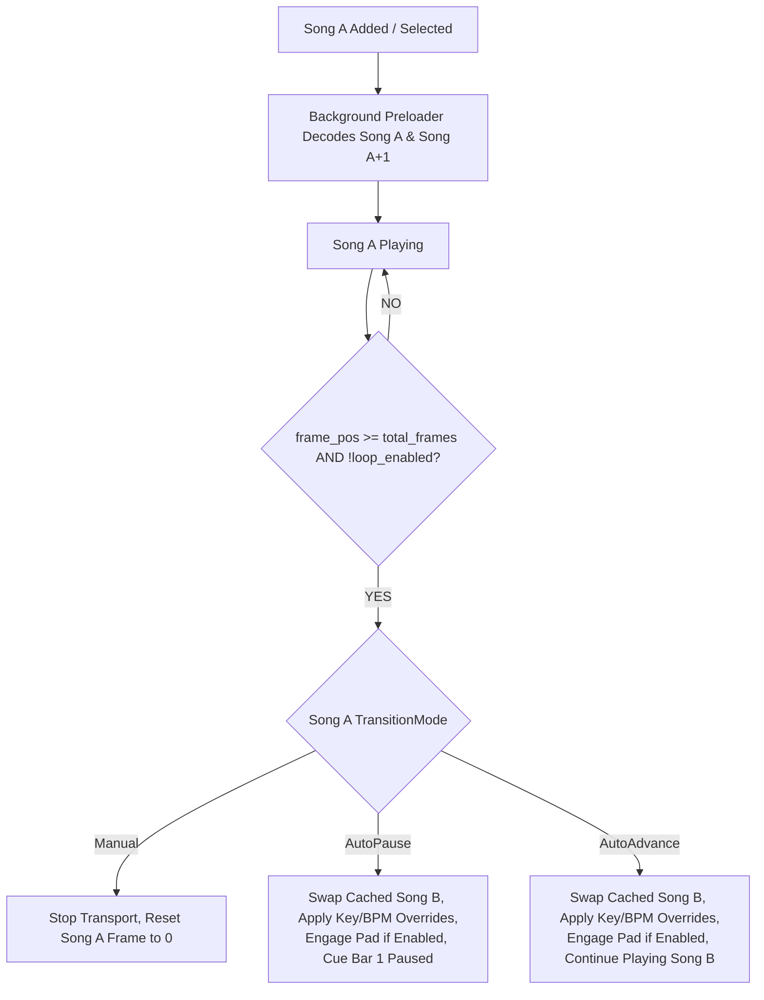

# SPEC-004: Multi-Song Setlist Engine & Seamless Flow Modes

| Metadata | Value |
| :--- | :--- |
| **Spec ID** | `SPEC-004` |
| **Title** | Multi-Song Setlist Engine & Seamless Flow Modes |
| **Module** | `crates/psalm-audio-core/src/manifest.rs`, `engine.rs`, `src-tauri/src/` |
| **Status** | Implemented & Verified |
| **Priority** | P1 (High) |
| **Related Specs** | [SPEC-003: Arrangement & Quantization](./SPEC-003-ARRANGEMENT-QUANTIZATION.md), [SPEC-006: Library & Bundle System](./SPEC-006-LIBRARY-BUNDLE-SYSTEM.md), [SPEC-007: Continuous Pads](./SPEC-007-CONTINUOUS-PADS.md), [SPEC-012: Native Picker & Song Setup](./SPEC-012-NATIVE-PICKER-AND-SONG-SETUP.md) |

---

## 1. Overview & Operational Requirements

Worship sets rarely consist of a single isolated song. A typical Sunday service features 3 to 6 songs flowing together into a cohesive worship arc.

The setlist engine manages:
1. **Ordered Multi-Song Queue & Non-Destructive Overrides**: Worship leaders can queue multiple song bundle directories (`song_dir`), reorder slots, remove slots, save/load `.json` setlists, and apply per-slot overrides (`key_shift_semitones`, `bpm_override`, `ambient_pad_enabled`, `pad_key_override`) without altering each song's `manifest.json`.
2. **Background Pre-Decoding (Zero-Stall Switching)**:
   - Decoding multitrack stems (WAV/FLAC/OGG/MP3) and resampling must never block the `psalm-mixer-dsp` render thread or interrupt a sustaining ambient drone pad.
   - When songs are added or the active slot changes, a background preloader thread decodes the active song (if not cached) and the upcoming adjacent song(s) at the engine's current sample rate, delivering pre-decoded `LoadedSong` instances into `MixerState` over a non-blocking channel.
3. **Flexible Song End Transition Modes**:
   - **`AutoAdvance` (Flow)**: When Song A reaches `total_frames`, the engine seamlessly transitions to Song B, applying Song B's key/BPM overrides and starting playback immediately (preserving continuous drone pad energy across the boundary).
   - **`AutoPause` (Wait for Cue)**: When Song A reaches `total_frames`, the engine loads and cues Song B at Bar 1, engages Song B's key-matched ambient drone pad (if `ambient_pad_enabled` is true), and pauses transport (`is_playing = false`) ready for a single tap or MIDI trigger.
   - **`Manual`**: Playback stops cleanly at the end of Song A and resets Song A to frame `0` (preserving manual control).

---

## 2. Data Model & Contracts

### 2.1 Persistent Setlist Schema (`setlist.json`)

```rust
#[derive(Debug, Clone, Copy, PartialEq, Eq, Serialize, Deserialize)]
pub enum TransitionMode {
    AutoAdvance,
    AutoPause,
    Manual,
}

impl Default for TransitionMode {
    fn default() -> Self {
        Self::AutoPause
    }
}

#[derive(Debug, Clone, Serialize, Deserialize)]
pub struct SetlistItem {
    pub song_id: String,
    #[serde(default)]
    pub song_dir: Option<String>,
    #[serde(default)]
    pub title: Option<String>,
    #[serde(default)]
    pub original_key: Option<String>,
    #[serde(default)]
    pub base_bpm: Option<f64>,
    #[serde(default)]
    pub key_shift_semitones: i32,
    #[serde(default)]
    pub bpm_override: Option<f64>,
    #[serde(default)]
    pub transition_mode: TransitionMode,
    #[serde(default = "default_crossfade_sec")]
    pub crossfade_sec: f32,
    #[serde(default = "default_true")]
    pub ambient_pad_enabled: bool,
    #[serde(default)]
    pub pad_key_override: Option<String>,
}

#[derive(Debug, Clone, Serialize, Deserialize)]
pub struct SetlistManifest {
    pub id: String,
    pub name: String,
    #[serde(default)]
    pub items: Vec<SetlistItem>,
}
```

### 2.2 `EngineCommand` & `EngineSnapshot` Extensions

Commands sent from UI / MIDI / Tauri IPC:
- `AddSetlistSong { dir: String, insert_at: Option<usize> }`
- `RemoveSetlistSlot(usize)`
- `MoveSetlistSlot { from: usize, to: usize }`
- `SelectSetlistSlot(usize)`
- `NextSong`
- `PrevSong`
- `UpdateSetlistSlotConfig { slot: usize, key_shift_semitones: Option<i32>, bpm_override: Option<Option<f64>>, transition_mode: Option<TransitionMode>, crossfade_sec: Option<f32>, ambient_pad_enabled: Option<bool> }`
- `LoadSetlist(SetlistManifest)`
- `ClearSetlist`

Snapshot fields emitted in `EngineSnapshot`:
- `setlist_name: String`
- `setlist_items: Vec<SetlistItemSnapshot>` (each exposing `slot`, `song_id`, `song_dir`, `title`, `original_key`, `effective_key`, `base_bpm`, `effective_bpm`, `key_shift_semitones`, `bpm_override`, `transition_mode`, `crossfade_sec`, `ambient_pad_enabled`, `preload_state: PreloadState`)
- `active_setlist_slot: Option<usize>`

Where `PreloadState` is `Unloaded | Loading | Ready | Error(String)`.

MIDI Control integration (`MidiTarget` in [SPEC-005](./SPEC-005-MIDI-STAGE-CONTROL.md)):
- `NextSong` and `PrevSong` are mappable hardware MIDI targets (e.g., dual footswitch next/previous song).

---

## 3. Transition & Preload State Machine



---

## 4. Verification & Testing Strategy

- **`test_setlist_manifest_validation`**: Validate range bounds (`key_shift_semitones` within `[-12, 12]`, `bpm_override` within `[30.0, 260.0]`, `crossfade_sec` within `[0.0, 10.0]`) and reject empty/invalid manifest states cleanly.
- **`test_transition_mode_serialization`**: Verify backward compatibility when deserializing legacy `SetlistManifest` JSON missing optional fields (`song_dir`, `transition_mode`, `ambient_pad_enabled`).
- **`test_setlist_flow_auto_pause_and_auto_advance`**: Simulate playback reaching `total_frames` for `Manual`, `AutoPause`, and `AutoAdvance`, verifying target slot index, key shift / BPM override application, pad state, and `is_playing` state without audio panics.
- **`test_setlist_reorder_preserves_active_song`**: Reordering slots updates `active_setlist_slot` to track the currently loaded song accurately.
