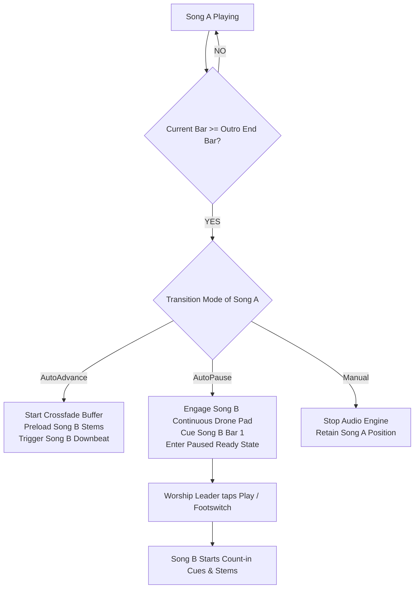

# SPEC-004: Multi-Song Setlist Engine & Seamless Flow Modes

| Metadata | Value |
| :--- | :--- |
| **Spec ID** | `SPEC-004` |
| **Title** | Multi-Song Setlist Engine & Seamless Flow Modes |
| **Module** | `crates/psalm-audio-core/src/manifest.rs`, `src-tauri/src/` |
| **Status** | Specification Ready / In Progress |
| **Priority** | P1 (High) |
| **Related Specs** | [SPEC-003: Arrangement & Quantization](./SPEC-003-ARRANGEMENT-QUANTIZATION.md), [SPEC-007: Continuous Pads](./SPEC-007-CONTINUOUS-PADS.md) |

---

## 1. Overview & Operational Requirements

Worship sets rarely consist of a single isolated song. A typical service features 3 to 6 songs flowing together into a cohesive worship arc.

The setlist engine must manage:
1. **Setlist Ordering & Non-Destructive Overrides**: Worship leaders must be able to change key (e.g. $+2$ semitones) or tempo (e.g. $74 \to 72\text{ BPM}$) for a specific Sunday service without modifying the original song package on disk.
2. **Flexible Song Transition Modes**:
   - **Auto-Advance (Flow)**: When Song A finishes, Song B automatically starts after a configurable crossfade delay ($0$ to $4\text{ seconds}$).
   - **Auto-Pause (Wait for Cue)**: When Song A finishes, the engine cues up Song B, engages continuous ambient drone pads in Song B's key, and pauses, waiting for a footswitch or spacebar tap from the leader.
   - **Manual Transition**: Song stops at the end of Song A; the leader manually selects the next track.

---

## 2. Setlist Data Model

```json
{
  "id": "sunday-service-2026-11-15",
  "name": "Sunday Morning Service - Nov 15",
  "items": [
    {
      "song_id": "living-hope",
      "title": "Living Hope",
      "target_key": "Db",
      "key_shift_semitones": 1,
      "bpm_override": 71.0,
      "transition_mode": "AutoPause",
      "ambient_pad_enabled": true
    },
    {
      "song_id": "graves-into-gardens",
      "title": "Graves Into Gardens",
      "target_key": "B",
      "key_shift_semitones": 0,
      "bpm_override": null,
      "transition_mode": "AutoAdvance",
      "crossfade_sec": 2.5
    },
    {
      "song_id": "worthy-is-the-lamb",
      "title": "Worthy Is The Lamb",
      "target_key": "G",
      "key_shift_semitones": -2,
      "bpm_override": 68.0,
      "transition_mode": "Manual"
    }
  ]
}
```

```rust
#[derive(Debug, Clone, Copy, PartialEq, Eq, Serialize, Deserialize)]
pub enum TransitionMode {
    AutoAdvance,
    AutoPause,
    Manual,
}

#[derive(Debug, Clone, Serialize, Deserialize)]
pub struct SetlistItem {
    pub song_id: String,
    pub title: Option<String>,
    #[serde(default)]
    pub key_shift_semitones: i32,
    #[serde(default)]
    pub bpm_override: Option<f64>,
    #[serde(default = "default_transition_mode")]
    pub transition_mode: TransitionMode,
    #[serde(default = "default_crossfade_sec")]
    pub crossfade_sec: f32,
}
```

---

## 3. Transition Flow State Machine



---

## 4. Verification & Testing Strategy

- **`test_setlist_manifest_validation`**: Verify that setlist items with invalid `song_id` or out-of-range BPM/transposition are rejected with descriptive errors.
- **`test_transition_mode_serialization`**: Ensure backwards compatibility across versions when deserializing `SetlistManifest` JSON.
- **`test_crossfade_tail_rendering`**: Verify that stems from Song A smoothly decay to zero while Song B begins without audio clipping.

