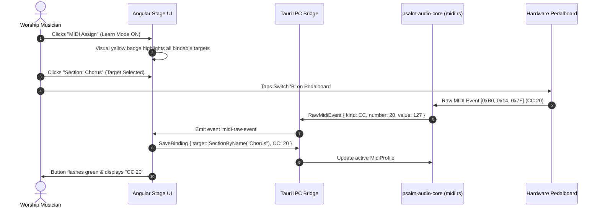

# SPEC-005: Hardware MIDI Stage Control, MIDI Learn & Live Lock

| Metadata | Value |
| :--- | :--- |
| **Spec ID** | `SPEC-005` |
| **Title** | Hardware MIDI Stage Control, MIDI Learn & Live Lock |
| **Module** | `crates/psalm-audio-core/src/midi.rs`, `src-tauri/src/midi_manager.rs` |
| **Status** | Implemented (Core) & Verified |
| **Priority** | P1 (High) |
| **Related Specs** | [SPEC-001: Audio Engine](./SPEC-001-AUDIO-ENGINE.md), [SPEC-008: Stage UI](./SPEC-008-STAGE-UI-SPARTAN.md) |

---

## 1. Overview & Stage Requirements

Worship musicians (especially guitarists, keyboardists, and drummers who also lead tracks) cannot operate a laptop keyboard or trackpad during a service. Hands are occupied by instruments.

Stage control must be:
1. **Footswitch Friendly**: Seamless integration with stage MIDI pedalboards (e.g., Morningstar MC3/MC6/MC8, Line 6 Helix / HX Stomp, Hotone Ampero Control, Behringer FCB1010).
2. **One-Click MIDI Learn**: Musicians must be able to click any on-screen button, fader, or section tile, tap a physical switch, and immediately store the binding.
3. **Local Machine Profile Persistence**: MIDI bindings must persist locally (`~/.psalm-stage/midi-profile.json` or app data) so that a musician's personal pedalboard setup never mutates shared cloud song libraries.
4. **Live Lock (Stage Armor)**: When armed, high-risk UI interactions (deleting stems, renaming sections, navigating away, closing the window) are strictly locked to prevent catastrophic stage accidents.

---

## 2. Supported MIDI Message Kinds & Behaviors

```rust
#[derive(Debug, Clone, Copy, PartialEq, Eq, Serialize, Deserialize)]
pub enum MidiMessageKind {
    Note,           // 0x90 Note On / 0x80 Note Off
    ControlChange,  // 0xB0 CC (Continuous Controllers 0..=127)
    ProgramChange,  // 0xC0 PC (Patches 0..=127)
}

#[derive(Debug, Clone, Copy, PartialEq, Eq, Serialize, Deserialize)]
pub enum MidiTriggerBehavior {
    Momentary,   // Fires action on Down (val > 0)
    Toggle,      // Flips state (val > 64)
    Continuous,  // Maps 0..127 to continuous fader 0.0..1.0
}
```

### 2.1 Target Actions

```rust
#[derive(Debug, Clone, PartialEq, Eq, Serialize, Deserialize)]
#[serde(tag = "type", content = "value")]
pub enum MidiTarget {
    PlayStop,
    Play,
    Stop,
    LoopToggle,
    SectionBySlot(usize),
    SectionByName(String),
    NextSection,
    PrevSection,
    KeyUp,
    KeyDown,
    TempoUp,
    TempoDown,
    MasterGain,
    ClickGain,
    CuesGain,
    StemGain(String),
}
```

---

## 3. The MIDI Learn Workflow



---

## 4. Live Lock Invariants

When **Live Lock** is active:
1. File drops, stem renames, delete commands, and song deletion are disabled.
2. Spacebar retains `PlayStop` functionality, but accidental double-tap filtering ($200\text{ ms}$ debounce) prevents accidental re-stops.
3. Fullscreen lock prevents OS desktop switching gestures during energetic stage performance.

---

## 5. Verification & Testing

Tests in `crates/psalm-audio-core/src/midi.rs` verify:
- **`test_parse_raw_midi_note_on`**: Correctly parses Note On messages with velocity $> 0$ and velocity $= 0$ (treated as Note Off).
- **`test_parse_raw_midi_control_change`**: Accurately extracts channel, controller number, and value.
- **`test_parse_raw_midi_program_change`**: Validates 2-byte Program Change decoding.
- **`test_parse_raw_midi_invalid`**: Ensures corrupt or truncated byte streams are safely dropped without panicking.
