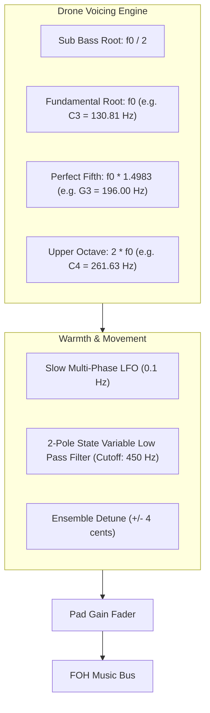

# SPEC-007: Ambient Drone Pad Engine & Cross-Key Stage Glue

| Metadata | Value |
| :--- | :--- |
| **Spec ID** | `SPEC-007` |
| **Title** | Ambient Drone Pad Engine & Cross-Key Stage Glue |
| **Module** | `crates/psalm-audio-core/src/pad.rs`, `engine.rs` |
| **Status** | Planned / Architecture Defined |
| **Priority** | P2 (Medium) |
| **Related Specs** | [SPEC-001: Audio Engine](./SPEC-001-AUDIO-ENGINE.md), [SPEC-004: Setlist Flow](./SPEC-004-SETLIST-FLOW.md) |

---

## 1. Overview & Problem Statement

In live modern worship sets, dead silence between songs breaks the flow of prayer, reflection, or speaking. Worship teams routinely run "ambient pads" (also known as continuous drone pads or stage glue) to sustain a warm, harmonic root-and-fifth bed beneath the room.

Existing workflows require worship teams to run a separate app or media player just to hold continuous pad audio. Integrating continuous pads directly into the Psalm Stage audio core provides:
1. **Key-Matched Automation**: The pad automatically matches the key of the active song in the setlist.
2. **Smooth Cross-Key Morphing**: When transitioning from Song A (Key of C) to Song B (Key of G), the pad performs an equal-power $4\text{ second}$ crossfade rather than an abrupt chord jump.
3. **Independent Stage Routing**: The pad can be routed to the main FOH stereo bus with its own independent volume fader and global mute.

---

## 2. Harmonic Architecture

Worship pads use an open "Root + Fifth + Octave" voicing (Power chord / $\text{P5}$ interval) with subtle chorus and low-pass filtering. This open voicing contains no 3rd (neither major nor minor), allowing it to harmonically support songs in both Major and Natural Minor keys seamlessly.

---

## 3. Cross-Key Transition Invariants

When transitioning between keys:
1. Crossfade duration is configurable ($2.0\text{ s}$ to $6.0\text{ s}$, default $4.0\text{ s}$).
2. Uses constant-power sine/cosine crossfade curves:
   $$\text{gain}_{\text{old}}(t) = \cos\left(\frac{\pi}{2} \cdot \frac{t}{T}\right)$$
   $$\text{gain}_{\text{new}}(t) = \sin\left(\frac{\pi}{2} \cdot \frac{t}{T}\right)$$
   This prevents a perceived volume dip during the harmonic transition.

---

## 4. Verification & Testing Strategy

- **`test_pad_equal_power_crossfade`**: Measure RMS level at $t = 0.5 T$ and confirm energy constancy within $\pm 0.5\text{ dB}$.
- **`test_pad_root_frequency_table`**: Ensure all 12 chromatic root frequencies ($C$ through $B$) match equal temperament $A4 = 440\text{ Hz}$.
- **`test_pad_mute_decay`**: Asserts that triggering Pad Mute engages a $500\text{ ms}$ exponential fade-out rather than an instantaneous click.
