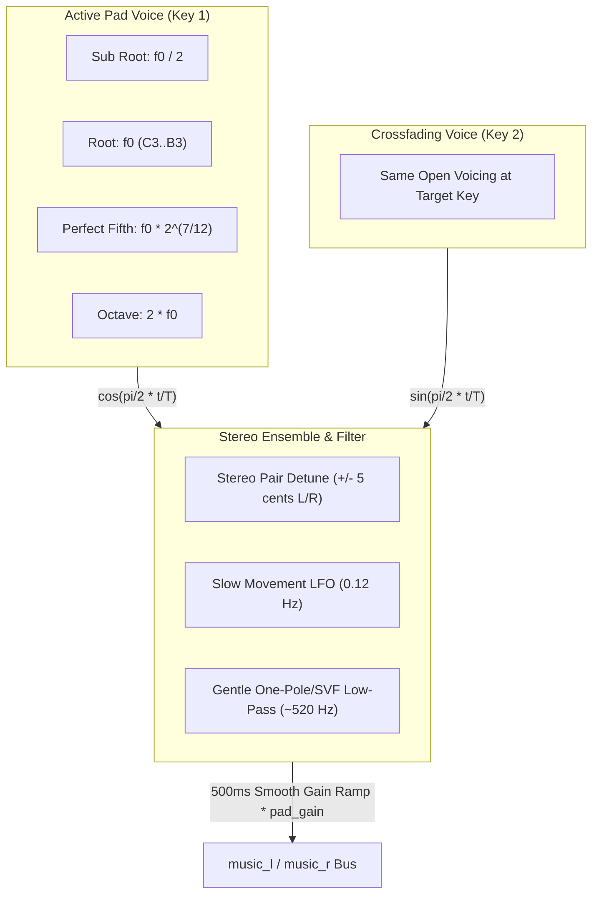

# SPEC-007: Ambient Drone Pad Engine & Cross-Key Stage Glue

| Metadata | Value |
| :--- | :--- |
| **Spec ID** | `SPEC-007` |
| **Title** | Ambient Drone Pad Engine & Cross-Key Stage Glue |
| **Module** | `crates/psalm-audio-core/src/pad.rs`, `engine.rs` |
| **Status** | Implemented & Verified |
| **Priority** | P1 (High) |
| **Related Specs** | [SPEC-001: Audio Engine](./SPEC-001-AUDIO-ENGINE.md), [SPEC-002: Click & Routing](./SPEC-002-CLICK-AND-ROUTING.md), [SPEC-004: Setlist Flow](./SPEC-004-SETLIST-FLOW.md), [SPEC-016: Tonic Pad Player](./SPEC-016-TONIC-PAD-PLAYER.md) |

---

## 1. Overview & Problem Statement

In live worship sets, abrupt dead silence between songs breaks the continuity of prayer, scripture reading, and transitions. Worship teams routinely run continuous ambient drone pads beneath spoken moments and song intros/outros to sustain a warm harmonic foundation.

Integrating continuous drone synthesis directly into `psalm-audio-core` guarantees:
1. **Continuous Between-Song Sustaining**: The pad synthesizer continues rendering smoothly into the FOH music bus **even when track transport is stopped or paused**, eliminating reliance on external pad apps.
2. **Automatic Key Following**: By default (`pad_follow_song_key = true`), the pad tracks the active song's effective musical key (`original_key` transposed by `key_shift_semitones`). Users may also pick any chromatic key (`C` through `B`) manually.
3. **Equal-Power Cross-Key Morphing**: Switching keys performs a configurable constant-power sine/cosine crossfade ($2.0\text{ s}$–$6.0\text{ s}$, default $4.0\text{ s}$) between dual oscillator voices so there is no audible chord cut or loudness dip.
4. **Click-Free Enable / Mute Ramping**: Enabling, muting, or disabling the pad smoothly ramps amplitude over $500\text{ ms}$ (never snapping instantaneously).
5. **Strict Music-Bus Isolation**: The pad routes strictly to `music_l` / `music_r` (and is affected by `master_gain`), **never** leaking into the dedicated click/cues output (`iem_l` / `iem_r`).

---

## 2. Harmonic & DSP Architecture

Worship pads use an open **Sub-Root + Root + Perfect Fifth + Octave** voicing with stereo detuned oscillators, slow breath LFO modulation, and a 2-pole low-pass warmth filter. Because the voicing omits the 3rd, each chromatic root supports both Major and Natural Minor keys cleanly.

### 2.1 Chromatic Key Normalization & Transposition

- Supported normalized chromatic labels: `C`, `Db`, `D`, `Eb`, `E`, `F`, `Gb`, `G`, `Ab`, `A`, `Bb`, `B`.
- Parser accepts sharp/flat synonyms (`C#` -> `Db`, `D#` -> `Eb`, `F#` -> `Gb`, `G#` -> `Ab`, `A#` -> `Bb`) and optional minor suffix (`Am` -> `A`, `F#m` -> `Gb`) by extracting the root tonic.
- Transposing a key label by `key_shift_semitones` shifts cleanly modulo 12 (`(base_pc + shift).rem_euclid(12)`).
- Base root frequencies (`C3`–`B3` register around $130.81\text{ Hz}$–$246.94\text{ Hz}$, computed via equal temperament $A4 = 440\text{ Hz}$).

---

## 3. Control Surface & Contracts

### `EngineCommand` Additions
- `SetPadEnabled(bool)`
- `SetPadMuted(bool)`
- `SetPadGain(f32)` (clamped `0.0..=1.5`)
- `SetPadKey(String)` (also disables auto-follow or switches target manual key; UI exposes an `Auto Key` toggle)
- `SetPadFollowSongKey(bool)`
- `SetPadCrossfadeSec(f32)` (clamped `1.0..=8.0`)

### `EngineSnapshot` Additions
- `pad_enabled: bool`
- `pad_muted: bool`
- `pad_gain: f32`
- `pad_key: String`
- `pad_follow_song_key: bool`

### MIDI Mapping (`MidiTarget` in [SPEC-005](./SPEC-005-MIDI-STAGE-CONTROL.md))
- `TogglePad` (toggle pad on/off or mute)
- `PadGain` (continuous CC fader/knob)

### Mixer Thread Invariant
When `state.is_playing == false` **and** `pad.is_active()` (either enabled/unmuted or ramping down), `psalm-mixer-dsp` continues feeding `render_block` at low CPU cost (pad-only frames, zero track stem/click work) into the `rtrb` ringbuffer so pad audio never stalls when song transport stops.

---

## 4. Verification & Testing Strategy

- **`test_pad_root_frequency_table`**: Verify all 12 chromatic keys and enharmonic/minor inputs (`C#`, `F#m`, `Bb`) resolve to exact $A4 = 440\text{ Hz}$ equal-temperament frequencies.
- **`test_pad_equal_power_crossfade`**: Verify that crossfading from key `C` to `G` produces smooth continuous RMS energy without dropouts or clipping above $1.0$.
- **`test_pad_mute_decay`**: Trigger mute/disable on an active pad and verify smooth exponential/linear ramp-down to zero over ~500 ms with zero hard discontinuity steps.
- **`test_pad_sustains_when_transport_stopped`**: Render blocks in `MixerState` while `is_playing == false` and `pad_enabled == true`; assert `music_l`/`music_r` contain pad energy while `iem_l`/`iem_r` remain silent (`0.0`).
