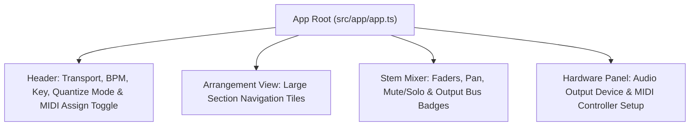

# SPEC-008: High-Contrast Stage UI, Tailwind CSS v4 & Spartan-ng

| Metadata | Value |
| :--- | :--- |
| **Spec ID** | `SPEC-008` |
| **Title** | High-Contrast Stage UI, Tailwind CSS v4 & Spartan-ng |
| **Module** | `src/app/`, `src/styles.css` |
| **Status** | Implemented (Core) & Verified |
| **Priority** | P1 (High) |
| **Related Specs** | [SPEC-003: Arrangement & Quantization](./SPEC-003-ARRANGEMENT-QUANTIZATION.md), [SPEC-005: MIDI Stage Control](./SPEC-005-MIDI-STAGE-CONTROL.md) |

---

## 1. Overview & Stage Ergonomics

Stage environments present severe visual and physical challenges:
- High contrast lighting changes (moving stage lights, haze, pitch-black wings).
- Viewing distances of $4$ to $10\text{ feet}$ away from a laptop stand on the floor or keyboard rig.
- High pressure, live moments where small icons or complex menus lead to errors.

The UI for Psalm Stage is designed from the ground up for live performance:
- High-contrast, dark-mode-first aesthetic with deep obsidian backgrounds (`#09090b`), fluorescent accents, and crisp typography.
- Giant, touchable section tiles with distinct color identities.
- Active section solid highlight + armed section pulsating glow so musicians know what is playing and what is queued at a glance.
- Real-time beat counter flashing on every downbeat.

---

## 2. Frontend Stack & Architecture

- **Angular 22 (Zoneless Architecture)**: Uses Angular Signals (`signal()`, `computed()`) for ultra-responsive, zero-overhead DOM updates without Zone.js monkey-patching.
- **Tailwind CSS v4**: Ultra-fast utility styling utilizing modern `@theme` variables.
- **Spartan-ng (`vega` / shadcn inspired)**: Accessible, unstyled primitives styled with Tailwind (Cards, Buttons, Switches, Sliders, Badges).

### 2.1 Component Hierarchy

---

## 3. UI Invariants & Stage States

| State | Visual Behavior | Visual Token |
| :--- | :--- | :--- |
| **Idle** | Play button green, beat counter dimmed | `bg-emerald-600` |
| **Playing** | Play button amber/stop, beat counter pulsing on beat 1 | `animate-pulse text-amber-400` |
| **Active Section** | Highlighted tile with high-contrast border and bright background | `border-amber-500 bg-amber-500/20 shadow-lg` |
| **Armed Section** | Flashing warning border indicating jump queued at quantization point | `animate-bounce border-cyan-400` |
| **Infinite Loop Active** | Loop badge active with cyan glow | `bg-cyan-500 text-white ring-2 ring-cyan-400` |
| **MIDI Learn Active** | Yellow badges overlaid on every mappable target | `bg-yellow-400 text-black font-mono` |

---

## 4. Verification & Testing

Angular unit tests in `src/app/app.spec.ts`:
- **`should create the app`**: Verifies injection of `PsalmStageService` and signal graph initialization.
- **`should render title`**: Verifies root DOM presence and high-contrast stage view structure.
- **`should handle keyboard shortcuts`**: Verifies that pressing `Space`, `L`, and number keys triggers the appropriate IPC commands.
