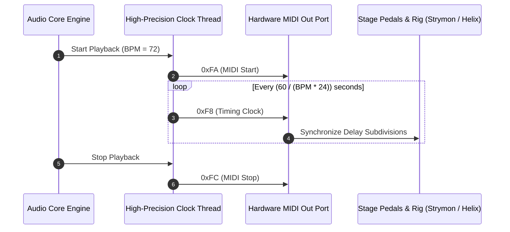

# SPEC-009: Outbound MIDI Beat Clock & Stage Automation

| Metadata | Value |
| :--- | :--- |
| **Spec ID** | `SPEC-009` |
| **Title** | Outbound MIDI Beat Clock & Stage Automation |
| **Module** | `crates/psalm-audio-core/src/midi.rs`, `engine.rs` |
| **Status** | Planned / Architecture Defined |
| **Priority** | P2 (Medium) |
| **Related Specs** | [SPEC-001: Audio Engine](./SPEC-001-AUDIO-ENGINE.md), [SPEC-005: MIDI Stage Control](./SPEC-005-MIDI-STAGE-CONTROL.md) |

---

## 1. Overview & Operational Requirements

Modern worship production relies heavily on synchronized stage systems:
1. **Guitar & Keyboard Effects Sync (MIDI Clock)**: Guitarists use delay and modulation pedals (Strymon Timeline, Line 6 Helix, Eventide, Chase Bliss) that sound best when quarter-note and dotted-eighth delays lock precisely to the song tempo.
2. **Lyric Projection Automation (ProPresenter)**: Video production teams can sync slide triggers automatically at section boundaries via MIDI cues (e.g. sending a specific Note On or Program Change when entering the Chorus).
3. **Amp Modeler & Vocal Processor Automation**: Automatically switching guitar patches (e.g. Clean $\to$ Rhythm $\to$ Ambient Lead) or vocal reverb intensity at key moments in the song.

---

## 2. Technical Architecture

### 2.1 MIDI Beat Clock (24 PPQN Invariant)

The standard MIDI Beat Clock protocol transmits 24 Timing Clock messages (`0xF8`) per quarter note:
$$\Delta t_{\text{clock}} = \frac{60}{\text{BPM} \times 24}\text{ seconds}$$
At $120\text{ BPM}$, a clock message must be transmitted every $20.833\text{ ms}$.



### 2.2 Song Section Automation Tracks

Within `manifest.json`, an optional `midi_cues` array specifies automated outbound events:
```json
{
  "midi_cues": [
    { "bar": 1, "beat": 1, "channel": 1, "type": "ProgramChange", "value": 0, "description": "Intro Clean Preset" },
    { "bar": 13, "beat": 1, "channel": 1, "type": "ProgramChange", "value": 1, "description": "Chorus Heavy Rhythm" },
    { "bar": 13, "beat": 1, "channel": 16, "type": "NoteOn", "note": 60, "velocity": 127, "description": "ProPresenter Chorus Slide" }
  ]
}
```

---

## 3. Verification & Testing Strategy

- **`test_midi_clock_interval_stability`**: Assert that simulated clock ticks do not drift by more than $0.2\text{ ms}$ over 1,000 iterations.
- **`test_midi_start_stop_sequence`**: Confirm proper framing with `0xFA` on play and `0xFC` on stop.
- **`test_section_midi_cue_dispatch`**: Verify that seeking or jumping sections dispatches the appropriate patch change for the target section.
