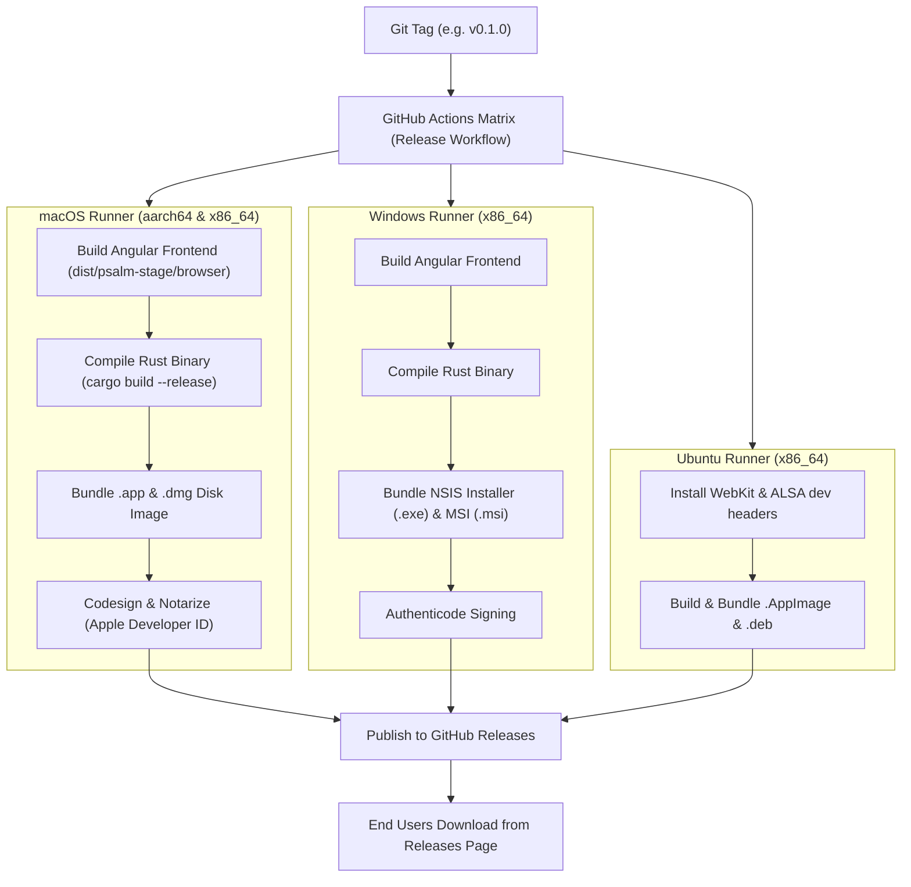

# SPEC-011: Automated Packaging, Installers & Distribution Pipeline

| Metadata | Value |
| :--- | :--- |
| **Spec ID** | `SPEC-011` |
| **Title** | Automated Packaging, Installers & Distribution Pipeline |
| **Module** | `.github/workflows/release.yml`, `src-tauri/tauri.conf.json` |
| **Status** | Implemented & Verified |
| **Priority** | P0 (Critical for Non-Developer End Users) |
| **Related Specs** | [SPEC-008: Stage UI](./SPEC-008-STAGE-UI-SPARTAN.md), [SPEC-010: Offline Caching](./SPEC-010-CLOUD-SYNC-OFFLINE.md) |

---

## 1. Overview & Operational Problem Statement

Worship pastors, band leaders, and volunteer sound technicians are **non-technical end users**. Expecting them to clone git repositories, install Node.js, install the Rust compiler toolchain, or run shell scripts in a terminal creates an insurmountable barrier to adoption and risks broken stage setups.

Psalm Stage must be distributed as **turnkey, double-clickable standalone installers**:
- **macOS**: Drag-and-drop `.dmg` disk image.
- **Windows**: Standard `.exe` installer (NSIS) or `.msi` package with Start Menu and Desktop shortcuts.
- **Linux**: Self-contained `.AppImage` and `.deb` packages.

---

## 2. Technical Architecture & Packaging Targets



---

## 3. Configuration Specifications (`tauri.conf.json`)

The desktop bundler is configured in `src-tauri/tauri.conf.json`:

```json
{
  "productName": "Psalm Stage",
  "version": "0.1.0",
  "identifier": "org.psalmstage.app",
  "build": {
    "frontendDist": "../dist/psalm-stage/browser",
    "beforeBuildCommand": "npm run build"
  },
  "bundle": {
    "active": true,
    "targets": "all",
    "category": "AudioVideo",
    "icon": [
      "icons/32x32.png",
      "icons/128x128.png",
      "icons/128x128@2x.png",
      "icons/icon.icns",
      "icons/icon.ico"
    ],
    "macOS": {
      "minimumSystemVersion": "10.15",
      "dmg": {
        "windowSize": { "width": 660, "height": 400 },
        "appPosition": { "x": 180, "y": 170 },
        "applicationFolderPosition": { "x": 480, "y": 170 }
      }
    },
    "windows": {
      "nsis": {
        "installMode": "currentUser"
      }
    }
  }
}
```

---

## 4. Release Automation Workflow

The release process is triggered by pushing a git tag:
```bash
git tag v0.1.0
git push origin v0.1.0
```
This automatically invokes `.github/workflows/release.yml`, compiling all platform targets and publishing the binary assets directly to the GitHub Releases page with release notes and SHA-256 checksums.

---

## 5. Verification & Testing

- **`test_dmg_bundle_structure`**: Verifies that the `.dmg` contains a valid `.app` bundle, `Applications` symlink, volume icon, and plist entries.
- **`test_windows_nsis_installer`**: Verifies that the NSIS installer properly writes uninstallation registry entries and installs cleanly in standard user directory without requiring Administrator elevation.

