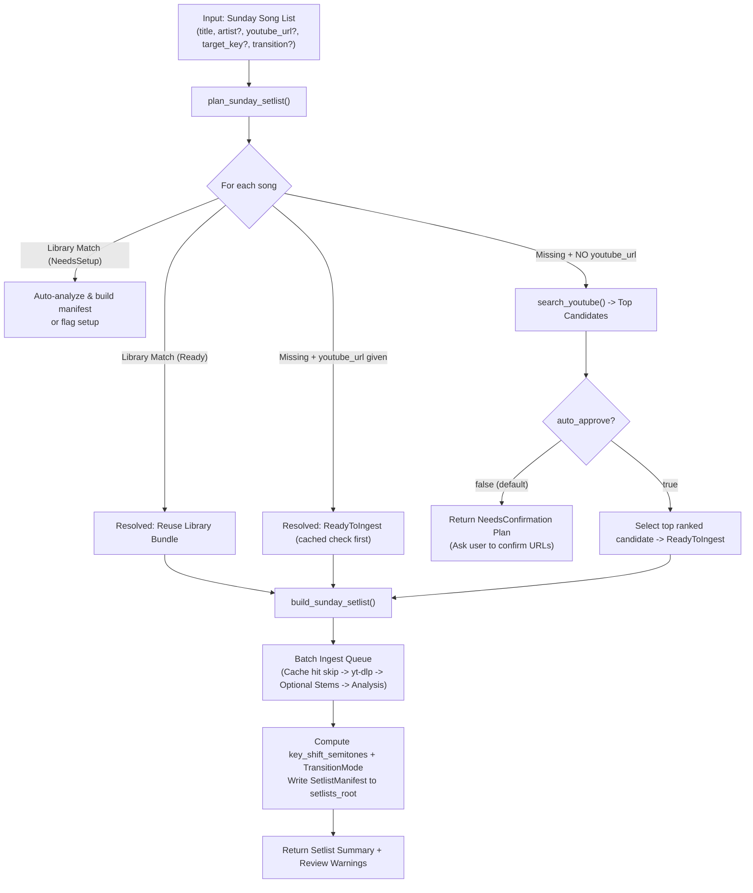

# SPEC-015: Headless Workbench, Managed Setlists & AI Harness Integration (CLI + MCP + Skill)

| Metadata | Value |
| :--- | :--- |
| **Spec ID** | `SPEC-015` |
| **Title** | Headless Workbench, Managed Setlists & AI Harness Integration (CLI + MCP + Skill) |
| **Module** | `crates/psalm-workbench`, `crates/psalm-stage-cli`, `crates/psalm-audio-core`, `src-tauri`, `src/app/` |
| **Status** | Implemented & Verified |
| **Priority** | P1 (High) |
| **Related Specs** | [SPEC-004: Multi-Song Setlist Flow](./SPEC-004-SETLIST-FLOW.md), [SPEC-011: Packaging & Distribution](./SPEC-011-PACKAGING-AND-DISTRIBUTION.md), [SPEC-013: Song Library & Setlist Studio](./SPEC-013-SONG-LIBRARY-AND-SETLIST-STUDIO.md), [SPEC-014: Audio Import & Stem Workbench](./SPEC-014-AUDIO-IMPORT-AND-STEM-WORKBENCH.md) |

---

## 1. Overview & Motivation

Worship leaders often plan Sunday services conversationally—listing songs, desired keys, medley transitions, and occasional YouTube links—before ever opening playback software. Today, Psalm Stage's Workbench (`SPEC-014`) and Setlist Studio (`SPEC-013`) are tightly coupled to the Tauri desktop GUI (`AppHandle` events, single active job lock, and file-picker dialogs), preventing an external AI harness (Claude Code, Codex, Antigravity, Gemini CLI, Cursor) from preparing a Sunday setlist end-to-end.

This specification enables an ergonomic, stage-safe **AI-driven setlist workflow**:
1. **Plan → Confirm → Build → Review**:
   - Accept a requested list of songs (with or without YouTube links, optional target keys, BPM overrides, and transition hints).
   - Resolve existing songs from the local Library first (by canonical source reference or fuzzy title/artist match).
   - For missing songs without a YouTube link, search YouTube via `yt-dlp` and present ranked candidates for **explicit user confirmation** before downloading or separating stems (with an opt-in `--auto-approve` / `auto_approve: true` override).
   - Ingest missing songs sequentially through the Workbench pipeline using `WorkbenchConfig.default_separation_engine` and `default_stem_preset`, gracefully falling back to `SeparationEngine::None` (direct stereo backing track) if local ML separators (`audio-separator`, `demucs`) are unavailable.
   - Compute deterministic `key_shift_semitones`, generate a valid `SetlistManifest` inside a managed Setlists folder, and surface newly created songs needing human Bar-1/section verification.
2. **Unified Headless Core + Dual AI Surface**:
   - Extract Workbench/Library/Setlist orchestration out of `src-tauri` into a shared headless Rust crate (`crates/psalm-workbench`).
   - Ship a single console-subsystem binary (`psalm-stage-cli`) bundled inside the Tauri desktop installers (`.dmg`, `.exe`, `.msi`, `.AppImage`, `.deb`) providing both a `--json` CLI and a stdio **Model Context Protocol (MCP)** server (`psalm-stage-cli mcp`), paired with a bundled `SKILL.md` and one-click in-app **AI Harness Setup**.

---

## 2. Architectural Principles & Stage Safety Invariants

1. **Zero Live-Stage Coupling & `liveLock` Protection**:
   - No CLI command, MCP tool, or filesystem watcher may stop, reload, or mutate active playback when `liveLock` is engaged in the desktop app.
   - New setlists and songs written externally appear non-destructively in **Setlist Studio** (or via a toast banner when not locked).
2. **Windows & Cross-Platform Stdio Safety**:
   - Because the main GUI binary (`src-tauri/src/main.rs`) compiles with `windows_subsystem = "windows"`, it detaches from console `stdin`/`stdout` on Windows.
   - Therefore, the CLI and MCP server MUST live in a dedicated console-subsystem sidecar binary (`psalm-stage-cli`) bundled via Tauri `externalBin`—never inside the GUI executable's `windows_subsystem` entrypoint.
3. **Single Source of Truth for Config Paths**:
   - Both `src-tauri` and `crates/psalm-workbench` MUST resolve configuration files (`library-config.json`, `workbench-config.json`) via one shared `resolve_app_config_dir()` function targeting the `org.psalmstage.app` app-config directory (with `PSALM_STAGE_CONFIG_DIR` environment override for headless testing).

---

## 3. Workspace & Data Model Extensions

### 3.1 Crate Extraction (`crates/psalm-workbench`)

Move GUI-independent orchestration from `src-tauri/src/workbench.rs` into `crates/psalm-workbench`:
- `WorkbenchConfig`, `LibraryConfig` path resolution (`resolve_app_config_dir()`).
- `ToolchainStatus`, `detect_toolchain_status()`, `YouTubeMetadata`, `YouTubeSearchCandidate`.
- `ImportJobRequest`, `ImportSource`, `SeparationEngine`, `StemPreset`, `WorkbenchJobProgress`.
- `run_import_job_pipeline(..., progress: &dyn ProgressSink)` using a trait/callback (`ProgressSink`) instead of `tauri::AppHandle`. `src-tauri` wraps `ProgressSink` to emit `workbench:job-progress` events; `psalm-stage-cli` logs progress to `stderr` (or MCP notifications) while keeping `stdout` strictly structured JSON / JSON-RPC.
- `ingest_songs_batch(...)`: deduplicates via `find_cached_library_bundle`, executes downloads/metadata, serializes CPU/GPU-heavy stem separation sequentially, and returns per-song structured summaries.

### 3.2 Managed Setlists Directory (`LibraryConfig`)

Extend `LibraryConfig` in `crates/psalm-audio-core/src/library.rs`:

```rust
#[derive(Debug, Clone, Serialize, Deserialize)]
pub struct LibraryConfig {
    pub library_root: String,
    #[serde(default = "default_setlists_root_string")]
    pub setlists_root: String,
    #[serde(default)]
    pub linked_folders: Vec<String>,
    #[serde(default)]
    pub recent_setlists: Vec<String>,
}
```

- Default `setlists_root`: `~/Music/PsalmStage/Setlists` (alongside `~/Music/PsalmStage/Library`).
- `list_managed_setlists(config: &LibraryConfig) -> Vec<SetlistSummary>`: scans `setlists_root` (`*.json`) plus valid `recent_setlists` paths, returning `{ path, id, name, song_count, total_estimated_sec, modified_ms }`.

### 3.3 AI / Workbench Review Provenance (`SongManifest`)

Extend `ImportProvenance` in `crates/psalm-audio-core/src/manifest.rs` with backward-compatible defaults:

```rust
#[derive(Debug, Clone, PartialEq, Serialize, Deserialize)]
pub struct ImportProvenance {
    pub source_kind: String,
    pub source_ref: String,
    #[serde(default, skip_serializing_if = "Option::is_none")]
    pub original_source: Option<String>,
    pub separation_engine: String,
    pub stem_preset: String,
    #[serde(default, skip_serializing_if = "Option::is_none")]
    pub custom_model: Option<String>,
    #[serde(default)]
    pub needs_review: bool,
    #[serde(default, skip_serializing_if = "Option::is_none")]
    pub key_confidence: Option<f32>,
    #[serde(default, skip_serializing_if = "Vec::is_empty")]
    pub review_notes: Vec<String>,
}
```

- When an automated import finishes:
  - Set `needs_review = true`.
  - Populate `key_confidence` from `AudioAnalysisResult`.
  - Add concise `review_notes` when `original_key == "Unknown"`, `key_confidence < 0.45`, or sections were auto-seeded without user waveform verification.
- Saving a manifest from the in-app **Import Workbench** clears `needs_review = false` (and clears auto-review notes) once the human saves their verified arrangement.

---

## 4. Resolution, YouTube Search & Musical Math Engines

### 4.1 Library Matching (`match_library_songs`)

Given a song query `{ title, artist?, youtube_url? }`:
1. **Exact Provenance Match (`1.0`)**: If `youtube_url` is provided, compute `canonicalize_source_ref("youtube", url)` and match against `entry.provenance.source_ref`.
2. **Normalized Fuzzy Match (`0.0..1.0`)**:
   - Strip bracketed/parenthetical suffixes (`(Live)`, `(Official Audio)`, `[Lyrics]`, `- Topic`), normalize punctuation/whitespace, and compute token + edit-distance similarity on `title` (and `artist` when supplied).
   - Rank candidates by `match_score`, preferring `LibraryEntryStatus::Ready` over `NeedsSetup` and `MissingStems`.
   - Thresholds: `>= 0.85` = high-confidence match; `0.60..0.85` = ambiguous candidate(s) surfaced for confirmation; `< 0.60` = treat as missing from Library.

### 4.2 YouTube Search (`search_youtube`)

- Invokes `yt-dlp --dump-json --flat-playlist --no-warnings "ytsearch{limit}:{query}"` (default `limit = 5`).
- Returns `Vec<YouTubeSearchCandidate>`: `{ video_id, title, channel, duration_sec, webpage_url, is_live }`.
- Ranking heuristics:
  - Filter or downrank shorts (`duration_sec < 90.0`), full-service/compilation videos (`duration_sec > 900.0`), and livestreams unless explicitly requested.
  - Boost official artist/worship channels and queries matching `"official audio"` / `"original"`.
- **Chapter Seeding**: When `probe_youtube` retrieves full video JSON for an approved URL, extract `chapters` (if present) and convert valid chapter timestamps into initial bar-aligned `SectionDef` markers after BPM/downbeat analysis; otherwise fall back to `Intro` + `Verse 1` (`SPEC-014`).

### 4.3 Deterministic Key-Shift Solver (`compute_semitone_shift`)

- Reuses `key_to_pitch_class` from `crates/psalm-audio-core/src/pad.rs`.
- Given `original_key` and `target_key`:
  - Computes signed delta in `[-6, +6]` (shortest chromatic distance; e.g., `B` to `G` = `-4`, `G` to `A` = `+2`).
  - Clamps cleanly within `[-12, +12]` per `SetlistManifest::validate()`.
  - If `original_key` is `"Unknown"` or unparseable, returns `0` alongside a structured warning (`"Original key unknown — target key shift defaulted to 0"`).

### 4.4 Separation Fallback Policy

When ingesting a song via AI workflow:
1. If caller specifies an explicit `separation_engine` / `stem_preset`, honor it (returning a clear error if that explicit tool is missing).
2. Otherwise, read `WorkbenchConfig.default_separation_engine` and `default_stem_preset`.
3. If the configured default engine (`AudioSeparator` or `Demucs`) is not installed/detected by `detect_toolchain_status()`, **gracefully fall back** to `SeparationEngine::None` (imports stereo `music.wav` / audio file) and include a non-fatal warning in the job & setlist report with the platform `install_hint`.

---

## 5. Plan → Confirm → Build State Machine



---

## 6. CLI & MCP Server Contracts (`crates/psalm-stage-cli`)

### 6.1 CLI Commands (`psalm-stage-cli`)

Every command supports `--json` for deterministic machine-readable output on `stdout` (progress logs on `stderr`).

| Command | Purpose |
| :--- | :--- |
| `psalm-stage-cli status [--json]` | Reports `library_root`, `setlists_root`, `config_dir`, and `ToolchainStatus` (`ffmpeg`, `yt_dlp`, `audio_separator`, `demucs`). |
| `psalm-stage-cli library list [--query <q>] [--status <ready\|needs_setup\|missing_stems>] [--json]` | Lists indexed library songs with keys, BPM, stems, and `needs_review` status. |
| `psalm-stage-cli library match --title <t> [--artist <a>] [--url <u>] [--json]` | Fuzzy-matches a single song against the Library. |
| `psalm-stage-cli youtube search <query> [--limit 5] [--json]` | Searches YouTube via `yt-dlp` and returns ranked candidates. |
| `psalm-stage-cli setlist plan --input <file\|-> [--auto-approve] [--json]` | Dry-run resolution: returns `ReadyFromLibrary`, `ReadyToIngest`, and `NeedsConfirmation` items + computed key shifts without writing files. |
| `psalm-stage-cli setlist build --input <file\|-> [--name <n>] [--output <path>] [--auto-approve] [--separation <auto\|none\|uvr\|demucs>] [--stems <2\|4\|6>] [--json]` | Executes pending ingests and writes the final `SetlistManifest`. Fails with exit code `2` and candidate payload if any song still requires YouTube confirmation and `--auto-approve` is not set. |
| `psalm-stage-cli setlist list [--json]` | Lists managed setlists in `setlists_root` and `recent_setlists`. |
| `psalm-stage-cli skill [--json]` | Prints the bundled AI workflow `SKILL.md` for harness installation. |
| `psalm-stage-cli mcp` | Starts the stdio JSON-RPC 2.0 MCP server. |

### 6.2 MCP Tools (`psalm-stage-cli mcp`)

Implements MCP stdio transport (`initialize`, `tools/list`, `tools/call`) exposing:
- `get_toolchain_status`
- `list_library_songs`
- `match_library_song`
- `search_youtube_tracks`
- `plan_sunday_setlist`
- `ingest_song`
- `ingest_songs_batch`
- `create_or_update_setlist`
- `list_setlists`
- `get_setlist`
- `get_ai_workflow_guide`

### 6.3 Bundled Agent Skill (`SKILL.md`)

Shipped in `docs/ai-skills/psalm-stage-setlist/SKILL.md` (and embedded into `psalm-stage-cli` and `src-tauri`):
- Always invoke `get_toolchain_status` / `plan_sunday_setlist` before downloading.
- Always present YouTube search candidates and ask the user to confirm before ingesting songs without explicit links (unless the user explicitly requested auto-approval).
- Map conversational flow hints (*"flow into"*, *"medley"*, *"no break"*) to `transition_mode: "AutoAdvance"` and `ambient_pad_enabled: true`.
- Report any `needs_review` songs (low `key_confidence`, `"Unknown"` key, or auto-generated sections) with a prompt to open them in **Import Workbench** prior to Sunday service.

---

## 7. Packaging, In-App AI Setup & Live Studio Sync

### 7.1 Bundled Installer Sidecar (`SPEC-011` Integration)

- Build `psalm-stage-cli` for the target triple and register it under `bundle.externalBin` in `src-tauri/tauri.conf.json` (`binaries/psalm-stage-cli`).
- Tauri bundles it directly inside:
  - macOS: `Psalm Stage.app/Contents/MacOS/psalm-stage-cli` (included in `.dmg` and `.pkg`)
  - Windows: `<InstallDir>/psalm-stage-cli.exe` (included in NSIS `.exe` and `.msi`)
  - Linux: bundled inside `.AppImage` and `/usr/bin` in `.deb`
- Update `.github/workflows/release.yml` and local `package.json` build hooks to compile `psalm-stage-cli` before `tauri build`.

### 7.2 In-App "AI Harness Setup" & Managed Setlists UI

1. **AI Harness Setup Drawer (in Setlist Studio / Workbench Settings)**:
   - Resolves the exact installed sidecar path (`psalm-stage-cli`) at runtime.
   - Displays a one-click **"Copy MCP Server Config"** JSON snippet ready to paste into Claude Code, Codex, Cursor, or Antigravity:
     ```json
     {
       "mcpServers": {
         "psalm-stage": {
           "command": "<resolved-path-to-psalm-stage-cli>",
           "args": ["mcp"]
         }
       }
     }
     ```
   - Displays a one-click **"Copy / Export Agent Skill (`SKILL.md`)"** button and (on macOS/Linux) an optional **"Link CLI to `~/.local/bin/psalm-stage-cli`"** action.
2. **Managed Setlists Drawer & Non-Disruptive Live Sync**:
   - Add Tauri IPC commands `list_managed_setlists` and `install_cli_symlink` (plus `get_ai_harness_info`).
   - Add a **Saved Setlists** list in **Setlist Studio** backed by `setlists_root` so AI-generated setlists are immediately clickable without OS file dialogs.
   - Display a subtle **`Review Needed`** badge on library/setlist songs where `provenance.needs_review == true` with a one-click **`Open in Workbench`** button.
   - Poll/watch `library_root` and `setlists_root` signatures in the background (when not in `liveLock()`): when new bundles or setlists appear on disk, refresh Library & Saved Setlists and surface a non-blocking banner (*"New setlist 'Sunday Nov 15' ready — Load in Studio"*).

---

## 8. Verification & Testing Strategy

- **Rust Unit Tests (`crates/psalm-workbench`, `crates/psalm-audio-core`, `crates/psalm-stage-cli`)**:
  - `test_fuzzy_library_matching_ranks_ready_and_normalizes_titles`: Verify `(Live)` / `[Official Video]` normalization, canonical YouTube ID priority, and `Ready > NeedsSetup` ranking.
  - `test_parse_youtube_search_results_and_filter_outliers`: Verify `yt-dlp` flat-playlist JSON parsing and filtering/penalizing `<90s` shorts and `>900s` compilations.
  - `test_compute_semitone_shift_shortest_path_and_unknown`: Verify `B -> G` yields `-4`, `G -> A` yields `+2`, enharmonics (`Db` vs `C#`) match, and `"Unknown"` yields `0` with warning.
  - `test_plan_sunday_setlist_requires_confirmation_without_auto_approve`: Verify dry-run plans return `NeedsConfirmation` for unlinked missing songs when `auto_approve == false`, and resolve cleanly when `auto_approve == true` or explicit URL is provided.
  - `test_batch_ingest_reuses_cache_and_falls_back_when_separator_missing`: Verify provenance cache deduplication skips re-download/re-separation and missing default ML tool gracefully falls back to `SeparationEngine::None` with warning.
  - `test_setlist_manifest_output_and_managed_listing`: Verify `build` writes valid `SetlistManifest` to `setlists_root` and `list_managed_setlists` discovers it.
  - `test_mcp_stdio_initialize_and_tools_list`: Verify `psalm-stage-cli mcp` handles JSON-RPC `initialize` and `tools/list` cleanly over in-memory reader/writer streams.
- **Angular Unit Tests (`Vitest`)**:
  - Saved Setlists drawer renders managed setlists and loads selected setlist into Setlist Studio.
  - Songs with `provenance.needs_review == true` render the review badge and route to Import Workbench.
  - Live refresh banner is suppressed/deferred whenever `liveLock()` is active.
  - AI Harness Setup panel renders valid MCP JSON using the resolved `psalm-stage-cli` path.
