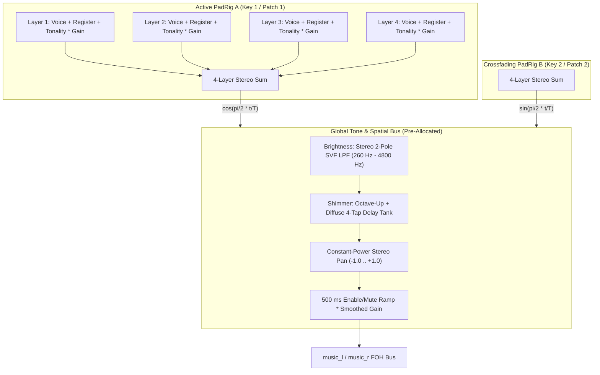

# SPEC-016: Tonic Pad Player — Multi-Layer Synthesis, Voicing & Setlist Preset Lock

| Metadata | Value |
| :--- | :--- |
| **Spec ID** | `SPEC-016` |
| **Title** | Tonic Pad Player — Multi-Layer Synthesis, Voicing & Setlist Preset Lock |
| **Module** | `crates/psalm-audio-core/src/pad.rs`, `pad_presets.rs`, `manifest.rs`, `engine.rs`, `midi.rs`, `src-tauri/src/`, `src/app/` |
| **Status** | Implemented & Verified |
| **Priority** | P1 (High) |
| **Extends** | [SPEC-007: Ambient Drone Pad Engine](./SPEC-007-CONTINUOUS-PADS.md) |
| **Related Specs** | [SPEC-001: Audio Engine](./SPEC-001-AUDIO-ENGINE.md), [SPEC-004: Setlist Flow](./SPEC-004-SETLIST-FLOW.md), [SPEC-005: MIDI Stage Control](./SPEC-005-MIDI-STAGE-CONTROL.md), [SPEC-008: Stage UI](./SPEC-008-STAGE-UI-SPARTAN.md) |

---

## 1. Overview & Motivation

[SPEC-007](./SPEC-007-CONTINUOUS-PADS.md) established Psalm Stage's continuous, FOH-isolated ambient drone pad engine with equal-power cross-key morphing. However, it is limited to a single hardcoded synth voice (`Sub-Root + Root + Fifth + Octave`), a fixed low-pass cutoff, and basic per-slot on/off flags.

Inspired by the **Tonic Pad Player** workflow (4-layer mixing, per-layer voicing/octave/minor mode, global tone shaping, user presets, and setlist Preset Lock vs. Pass-Through), this specification upgrades Psalm Stage's pad engine into a full **pure-synthesis** ambient pad workstation with zero external sample dependencies.

### Core Goals
1. **4-Layer Real-Time Synth Rig**: Blend up to 4 independent, stereo-detuned pad layers simultaneously—each with its own voice archetype, octave register (`Low` / `Mid` / `High`), tonality (`OpenFifth` / `Major` / `Minor` / `Melodic` / `Auto`), and level.
2. **True Minor Key Support**: Detect minor keys (`Am`, `F#m`, `Bb minor`, etc.) when auto-following song keys or selecting manually, enabling minor-3rd voicings for true minor songs while preserving neutral open-5th options per layer.
3. **Global Tone, Shimmer & Spatial Shaping**: Real-time **Brightness** (stereo 2-pole SVF low-pass sweep), **Shimmer** (pre-allocated octave-up diffuse harmonic wash), **Stereo Pan**, and user-controllable **Crossfade Duration** (`0.5 s`–`12.0 s`).
4. **Seamless Dual-Rig Crossfading**: Switching keys, presets, or layer voicings triggers an equal-power crossfade between two complete 4-layer rigs (`RigA` -> `RigB`), eliminating clicks, phase resets, or abrupt timbre jumps.
5. **Curated Factory + User Presets**: 14 built-in worship presets shipped inside `psalm-audio-core` plus locally persisted User Presets (`pad-presets.json`).
6. **Setlist Preset Lock vs. Pass-Through**: Lock a snapshot of pad settings (enabled state, volume, 4-layer mix, brightness, shimmer, pan) to any setlist slot *without* locking key, while unlocked slots act as **Pass-Through** so live stage tweaks carry smoothly across breaks, prayers, and adjacent songs.

### Non-Negotiable Audio Thread Invariants
- **Zero Heap Allocations**: All layer buffers, shimmer delay lines, and dual crossfade rigs (`RigA` / `RigB`) MUST be fixed-size or pre-allocated in `PadSynth::new` / `set_sample_rate`. The `psalm-mixer-dsp` render callback must never allocate, deallocate, or lock a mutex.
- **FOH Bus Isolation**: Pad output routes strictly to `music_l` / `music_r` (scaled by `master_gain`) and NEVER enters `iem_l` / `iem_r`.
- **Stopped-Transport Sustain**: Continues rendering smoothly while `is_playing == false` whenever active or fading out.

---

## 2. Synthesis & DSP Architecture



### 2.1 Musical Key, Quality & Transposition

Update key helpers in `crates/psalm-audio-core/src/pad.rs`:

```rust
#[derive(Debug, Clone, Copy, PartialEq, Eq, Serialize, Deserialize, Default)]
pub enum PadKeyQuality {
    #[default]
    Major,
    Minor,
}
```

- `parse_pad_key(raw: &str) -> Option<(usize, PadKeyQuality)>`:
  - Extracts pitch class `0..12` (`C = 0`) and `PadKeyQuality`.
  - Suffixes `"m"`, `"min"`, `"minor"` (case-insensitive, e.g., `"Am"`, `"F#m"`, `"Bb minor"`) resolve to `PadKeyQuality::Minor`.
  - All other valid root names (including `"maj"`, `"major"`, or bare `"G"`, `"C#"`) resolve to `PadKeyQuality::Major`.
- `format_pad_key(pc: usize, quality: PadKeyQuality) -> String`:
  - Formats canonical label from `CHROMATIC_KEYS[pc % 12]` plus `"m"` when `Minor` (e.g., `"Am"`, `"F#m"`, `"G"`).
- `transpose_pad_key(raw: &str, semitones: i32) -> String`:
  - Shifts pitch class modulo 12 while preserving `PadKeyQuality` (e.g., `"Am"` shifted `+2` -> `"Bm"`).

### 2.2 Voice Archetypes, Register & Tonality

Each of the 4 layers in a `PadRig` holds a `PadLayerConfig`:

```rust
#[derive(Debug, Clone, Copy, PartialEq, Eq, Serialize, Deserialize)]
pub enum PadVoiceArchetype {
    WarmAnalog,     // Soft-saturated detuned triangle/saw + warm fundamental
    BrightSynth,    // Wide stereo supersaw-style harmonic chorus
    EvolvingMotion, // Dual-LFO phase-modulated harmonic drift
    StringsCello,   // Bow-textured odd-harmonic ensemble + gentle vibrato
    OrganPad,       // Drawbar harmonic stack (16', 8', 5th, 4') + rotary motion
    GuitarSwell,    // Plucked-harmonic sustain shimmer with slow swell LFO
    ReversePiano,   // Overlapping dual reversed-envelope bell/piano grains
    AiryChoir,      // Formant-shaped breathy vowel harmonics
}

#[derive(Debug, Clone, Copy, PartialEq, Eq, Serialize, Deserialize, Default)]
pub enum PadRegister {
    Low,  // f0 * 0.5 (C2..B2)
    #[default]
    Mid,  // f0 (C3..B3)
    High, // f0 * 2.0 (C4..B4)
}

#[derive(Debug, Clone, Copy, PartialEq, Eq, Serialize, Deserialize, Default)]
pub enum PadTonality {
    #[default]
    Auto,      // Minor key -> Minor voicing; Major key -> OpenFifth
    OpenFifth, // Sub/Root + Fifth + Octave (harmonic glue, no 3rd)
    Major,     // Root + Major 3rd (subtle) + Fifth + Octave
    Minor,     // Root + Minor 3rd + Fifth + Octave
    Melodic,   // Root + Fifth + Ninth + Octave (lush suspended shimmer)
}

#[derive(Debug, Clone, PartialEq, Serialize, Deserialize)]
pub struct PadLayerConfig {
    pub enabled: bool,
    pub archetype: PadVoiceArchetype,
    pub register: PadRegister,
    pub tonality: PadTonality,
    /// Layer mix level: 0.0..=1.0
    pub gain: f32,
}
```

#### Voicing Interval Rules
- `OpenFifth`: intervals `[0, 7, 12]` (+ subtle `-12` sub on `Low` register).
- `Major`: intervals `[0, 4, 7, 12]` (3rd weighted at `0.45x` root so it supports rather than clashes).
- `Minor`: intervals `[0, 3, 7, 12]` (minor 3rd weighted at `0.55x` root for unmistakable minor color).
- `Melodic`: intervals `[0, 7, 12, 14]` (adds major 9th color).
- `Auto`: resolves to `Minor` when `PadKeyQuality::Minor`, and `OpenFifth` when `PadKeyQuality::Major`.

#### Archetype Synthesis Details (Zero-Alloc)
Each layer maintains fixed arrays of stereo phase accumulators (`4` partials x `2` stereo detuned voices), `2` LFO phases, and a per-layer envelope/grain phase (used by `ReversePiano` to overlap two 3.2 s slow-attack ramp-up / fast-taper grains 180° out of phase for continuous infinite sustain without sudden clicks).

### 2.3 Global Tone, Shimmer & Crossfade Smoothing

1. **Brightness (`0.0..=1.0`, default `0.55`)**:
   - Exponentially maps `0.0 -> 260 Hz`, `0.55 -> 1250 Hz`, `1.0 -> 4800 Hz` into a stereo 2-pole Chamberlin/SVF low-pass filter (`Q = 0.707`, unconditionally stable across `44.1 kHz`–`96 kHz`).
2. **Shimmer (`0.0..=1.0`, default `0.20`)**:
   - Pre-allocated fixed stereo delay tank (`4` mutually prime delay lines scaled by sample rate, max `96000 * 0.25` samples each allocated once on init/sample-rate change) fed by an octave-up + fifth harmonic tap from the active rigs.
   - Smoothly mixed in via smoothed parameter `shimmer_smooth`.
3. **Stereo Pan (`-1.0..=1.0`, default `0.0`)**:
   - Constant-power panner: `theta = (pan + 1.0) * PI / 4.0`, `gain_l = cos(theta)`, `gain_r = sin(theta)`.
4. **Dual-Rig Crossfader (`crossfade_sec`: `0.5..=12.0`, default `4.0`)**:
   - Triggered whenever **key/quality**, **preset**, or **layer archetype/register/tonality/enabled** changes while active.
   - If a crossfade is already in flight (`rig_b.is_some()`), `rig_b` is promoted to `rig_a` (or blended at current crossfade gain) so rapid preset browsing or consecutive key jumps never glitch.
   - **Continuous Parameter Smoothing**: Master `gain`, per-layer `gain`, `brightness`, `shimmer`, and `pan` slew smoothly (`~30 ms` one-pole smoothing) in place without restarting a multi-second rig crossfade.

---

## 3. Factory & User Preset System

### 3.1 Preset Data Model

```rust
#[derive(Debug, Clone, PartialEq, Serialize, Deserialize)]
pub struct PadPreset {
    pub id: String,
    pub name: String,
    pub category: String, // "Classic", "Textural", "Motion", "Minor", "Custom"
    #[serde(default)]
    pub is_factory: bool,
    pub layers: Vec<PadLayerConfig>, // 1..=4 layers (padded/clamped to 4)
    pub brightness: f32,
    pub shimmer: f32,
    #[serde(default)]
    pub pan: f32,
    #[serde(default)]
    pub crossfade_sec: Option<f32>,
}
```

### 3.2 Bundled Factory Presets (`crates/psalm-audio-core/src/pad_presets.rs`)

At least 14 factory presets covering Prime Tonic's core palette:
1. `classic-foundation` — **Classic Foundation** (WarmAnalog Mid OpenFifth)
2. `classic-bright` — **Classic Bright** (BrightSynth Mid/High + higher Brightness)
3. `classic-warm` — **Classic Warm** (WarmAnalog Low + Mid, lower Brightness)
4. `classic-dark` — **Classic Dark** (WarmAnalog Low + StringsCello Low, ~340 Hz cutoff)
5. `evolving-motion` — **Evolving Motion** (EvolvingMotion Mid + WarmAnalog Low + AiryChoir High)
6. `moody-strings` — **Moody Strings** (StringsCello Low + Mid + WarmAnalog Low)
7. `warm-organ` — **Warm Organ** (OrganPad Mid + WarmAnalog Low)
8. `guitar-swell` — **Guitar Swell** (GuitarSwell Mid/High + WarmAnalog Low + Shimmer)
9. `reverse-piano` — **Reverse Piano** (ReversePiano Mid/High + WarmAnalog Mid)
10. `shimmer-cathedral` — **Shimmer Cathedral** (AiryChoir High + BrightSynth Mid + high Shimmer)
11. `deep-sub-drone` — **Deep Sub Drone** (WarmAnalog Low + StringsCello Low)
12. `airy-choir` — **Airy Choir** (AiryChoir Mid/High + EvolvingMotion Mid)
13. `melodic-horizon` — **Melodic Horizon** (EvolvingMotion Melodic + ReversePiano Melodic)
14. `minor-lament` — **Minor Lament** (StringsCello Minor + WarmAnalog Low + AiryChoir Minor)

### 3.3 User Preset Persistence

- Stored at `<app_config_dir>/pad-presets.json` using the shared `resolve_app_config_dir()` root (`SPEC-015`).
- `PadPresetLibrary` supports:
  - `list_all_presets()` -> Factory presets followed by sorted User presets.
  - `save_user_preset(preset)` -> Validates 1..=4 layers, clamps values, assigns slug/UUID if new, writes atomically.
  - `delete_user_preset(id)` -> Rejects deleting factory presets; removes user preset and saves atomically.

---

## 4. Setlist Integration: Preset Lock vs. Pass-Through

### 4.1 Upgraded `SetlistItem` Schema (`crates/psalm-audio-core/src/manifest.rs`)

```rust
#[derive(Debug, Clone, PartialEq, Serialize, Deserialize)]
pub struct PadLockConfig {
    pub enabled: bool,
    pub gain: f32,
    #[serde(default)]
    pub preset_id: Option<String>,
    #[serde(default)]
    pub preset_name: Option<String>,
    pub layers: Vec<PadLayerConfig>, // Snapshot of up to 4 layers (self-contained)
    pub brightness: f32,
    pub shimmer: f32,
    #[serde(default)]
    pub pan: f32,
}
```

Extend `SetlistItem`:
- Retain `ambient_pad_enabled: bool` (default `true`) and `pad_key_override: Option<String>` (default `None`).
- Add:
  ```rust
  #[serde(default, skip_serializing_if = "Option::is_none")]
  pub pad_lock: Option<PadLockConfig>,
  ```

### 4.2 Automatic Upgrade & Runtime Transition Rules

1. **Legacy Setlist Upgrade**:
   - Any existing `setlist.json` lacking `pad_lock` deserializes cleanly with `pad_lock: None` (Pass-Through).
   - No manual migration step is required; saving the setlist writes the upgraded schema.
2. **When `pad_lock` is `Some(lock)` (Locked Slot)**:
   - Activating the setlist slot (via `SelectSetlistSlot`, `NextSong`, `PrevSong`, or `AutoAdvance`/`AutoPause` transition) recalls `lock`:
     - Sets `pad.enabled = lock.enabled` (and `muted = false` if enabling).
     - Applies `lock.gain`, `lock.preset_id`, `lock.preset_name`, `lock.layers`, `lock.brightness`, `lock.shimmer`, `lock.pan`.
     - Crossfades smoothly from the previous pad timbre over `crossfade_sec`.
   - **Key Independence**: `PadLockConfig` deliberately does **not** store a key. The pad key resolves from `item.pad_key_override`, or from the song's effective key (`original_key` transposed by `key_shift_semitones`, including `Major`/`Minor` quality) when `follow_song_key == true`.
3. **When `pad_lock` is `None` (Pass-Through Slot)**:
   - Activating the slot leaves the current pad's `enabled`, `muted`, `gain`, active preset/layers, `brightness`, `shimmer`, and `pan` **untouched**—so live stage tweaks and ongoing prayer pads flow seamlessly across slots.
   - If `follow_song_key == true` (or `item.pad_key_override` is `Some`), the pad crossfades only its **key** to match the slot.
   - During an `AutoPause` song-end transition (`SPEC-004`), if the pad is currently `OFF` and `next_item.ambient_pad_enabled == true`, the engine still auto-engages the pad as before; if the pad is already running (or was locked on), Pass-Through preserves its live mix.

---

## 5. Control Surface, MIDI & IPC Contracts

### 5.1 `EngineCommand` Additions (`crates/psalm-audio-core/src/engine.rs`)

```rust
pub struct PadPatchSpec {
    pub preset_id: Option<String>,
    pub preset_name: String,
    pub layers: Vec<PadLayerConfig>,
    pub brightness: f32,
    pub shimmer: f32,
    pub pan: f32,
    pub crossfade_sec: Option<f32>,
}
```

New `EngineCommand` variants:
- `SetPadPatch(PadPatchSpec)` — loads a preset or full 4-layer mix with crossfade.
- `SetPadLayer { index: usize, layer: Option<PadLayerConfig> }` — edits or clears layer `0..4` with crossfade if archetype/register/tonality/enabled changed.
- `SetPadLayerGain { index: usize, gain: f32 }` — smooth real-time fader adjustment for layer `0..4`.
- `SetPadBrightness(f32)` — clamped `0.0..=1.0`.
- `SetPadShimmer(f32)` — clamped `0.0..=1.0`.
- `SetPadPan(f32)` — clamped `-1.0..=1.0`.
- `LockCurrentPadToSlot(usize)` — captures current pad state into `setlist_items[slot].pad_lock = Some(...)`.
- `ClearSlotPadLock(usize)` — sets `setlist_items[slot].pad_lock = None` (Pass-Through).

`UpdateSetlistSlotConfig` also accepts `pad_lock: Option<Option<PadLockConfig>>`.

### 5.2 `EngineSnapshot` & `SetlistItemSnapshot` Additions

`EngineSnapshot`:
- `pad_preset_id: Option<String>`
- `pad_preset_name: String`
- `pad_layers: Vec<PadLayerConfig>` (4 entries; disabled slots have `enabled: false`)
- `pad_brightness: f32`
- `pad_shimmer: f32`
- `pad_pan: f32`
- `pad_crossfade_sec: f32`
- `pad_is_minor: bool`

`SetlistItemSnapshot`:
- `pad_lock: Option<PadLockConfig>`

### 5.3 `MidiTarget` Additions (`SPEC-005` / `midi.rs` + `midi_manager.rs`)

- `PadBrightness` (Continuous CC -> `0.0..=1.0`)
- `PadShimmer` (Continuous CC -> `0.0..=1.0`)
- `PadCrossfade` (Continuous CC -> `0.5..=12.0` sec)
- `PadPresetNext` / `PadPresetPrev` (Momentary/Toggle -> cycles through available presets via Tauri/engine bridge or preset list)
- `PadKeyNext` / `PadKeyPrev` (Momentary -> steps chromatic pad key +/- 1 semitone)

### 5.4 Tauri Commands (`src-tauri/src/lib.rs`)

- `list_pad_presets() -> Result<Vec<PadPreset>, String>`
- `save_user_pad_preset(preset: PadPreset) -> Result<Vec<PadPreset>, String>`
- `delete_user_pad_preset(id: String) -> Result<Vec<PadPreset>, String>`

---

## 6. Stage UI & Studio Design (`SPEC-008`)

### 6.1 Compact Stage Pad Card (`src/app/app.html`)
- Retains low-glare dark high-contrast Spartan-ng layout:
  - Header badge: `SUSTAINING Am` / `MUTED` / `OFF` + active **Preset Name** pill + **Lock / Pass-Through** toggle button for the active setlist slot (shows padlock icon when locked to the current slot).
  - Key selector: 12 chromatic keys + `Minor` quality toggle (auto-synced when `Auto-Follow Song Key` is active).
  - Quick sliders: **Pad Level** (MIDI mappable) + quick **Brightness** & **Shimmer** mini-meters or sliders.
  - **"Tonic Studio"** button opening the 4-Layer Pad Designer modal/drawer.

### 6.2 Tonic Pad Studio Drawer / Modal
- **Left Column — Presets**:
  - Filter tabs (`All`, `Factory`, `Custom`), search/scroll list of Factory + User presets, **Save As Preset** action, delete button for custom presets.
- **Center/Right — 4-Layer Mixer**:
  - 4 horizontal layer strips (`Layer 1`..`Layer 4`):
    - Enable/Clear toggle
    - **Voice Archetype** dropdown (`Warm Analog`, `Bright Synth`, `Evolving Motion`, `Strings / Cello`, `Organ Pad`, `Guitar Swell`, `Reverse Piano`, `Airy Choir`)
    - **Voicing Controls**: `Register` segmented buttons (`Low` / `Mid` / `High`) + `Tonality` selector (`Auto` / `Open 5th` / `Major` / `Minor` / `Melodic`)
    - **Layer Volume** slider (`0..100%`)
- **Bottom Bar — Global Tone & Transition**:
  - **Brightness** (`0..100%`), **Shimmer** (`0..100%`), **Stereo Pan** (`L 100` — `C` — `R 100`), **Crossfade Time** (`0.5s`–`12.0s`).
  - **Lock to Active Slot** button (when a setlist slot is active).

### 6.3 Setlist Studio Integration (`src/app/components/setlist-studio/`)
- Per-slot indicator badge showing either `Pad Locked: <Preset>` or `Pad: Pass-Through` (with quick clear-lock action).

---

## 7. Verification & Automated Test Plan

1. **Rust Audio Core (`crates/psalm-audio-core`)**:
   - `test_pad_key_quality_and_transposition`: Verify `"Am"`, `"F#m"`, `"Bb minor"` parse as `Minor` and transpose accurately (`"Am" + 2 -> "Bm"`).
   - `test_pad_minor_vs_major_spectrum`: Verify `Minor` tonality generates energy at the minor 3rd (`3` semitones above root) rather than major 3rd (`4` semitones).
   - `test_pad_preset_and_layer_crossfade`: Verify switching presets or layers while active triggers smooth constant-power crossfade without clipping or silence gaps across `44.1 kHz`, `48 kHz`, and `96 kHz`.
   - `test_pad_brightness_and_shimmer_bounds`: Verify brightness increases high-frequency energy cleanly, shimmer adds diffuse tail energy, and all audio stays bounded (`<= 1.0`) with zero NaNs.
   - `test_pad_rig_zero_alloc_and_bus_isolation`: Verify `music_l`/`music_r` carry multi-layer pad energy while `iem_l`/`iem_r` stay exact `0.0` during stopped transport.
   - `test_setlist_preset_lock_and_passthrough`: Verify locked slots restore preset/layers/tone/enabled state while still following song key, and unlocked (`None`) slots preserve live pad settings across slot switches.
   - `test_legacy_setlist_upgrade_deserialization`: Verify old `setlist.json` payloads without `pad_lock` deserialize cleanly as Pass-Through.
   - `test_user_pad_preset_persistence`: Verify saving/listing/deleting user presets in a temp config dir and protecting factory presets from deletion.
2. **Frontend (`src/app/`)**:
   - Update `PsalmStageService` web fallback mock + `app.spec.ts` tests for preset loading, layer updates, brightness/shimmer/pan/crossfade controls, minor key toggle, and setlist Preset Lock / Pass-Through behavior.
   - Verify `cargo test --workspace`, `npx ng test --watch=false`, and `npm run build` all pass cleanly.
