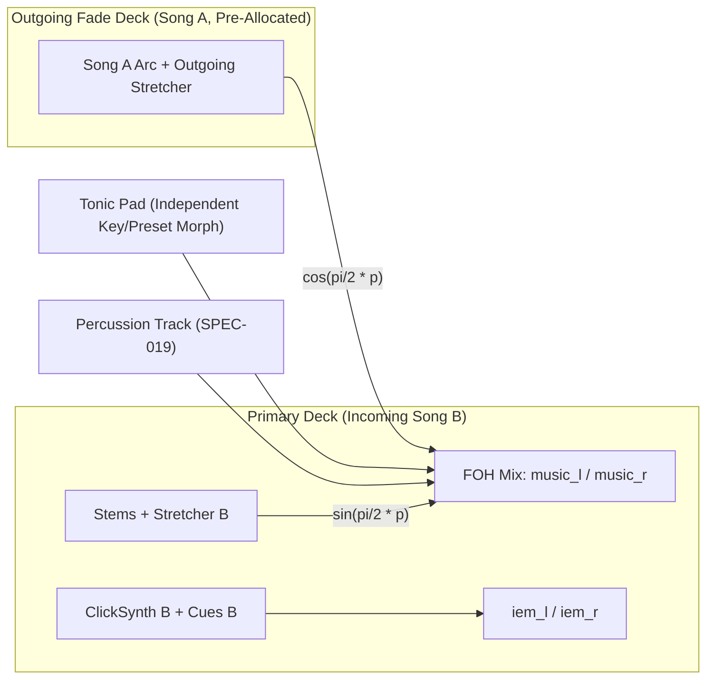

# SPEC-018: Real-Time Song-to-Song Overlap Crossfade Engine

| Metadata | Value |
| :--- | :--- |
| **Spec ID** | `SPEC-018` |
| **Title** | Real-Time Song-to-Song Overlap Crossfade Engine |
| **Module** | `crates/psalm-audio-core/src/engine.rs`, `manifest.rs`, `src/app/` |
| **Status** | Implemented |
| **Priority** | P1 (High) |
| **Extends** | [SPEC-004: Multi-Song Setlist Engine](./SPEC-004-SETLIST-FLOW.md), [SPEC-001: Real-Time DSP Audio Engine](./SPEC-001-AUDIO-ENGINE.md) |
| **Related Specs** | [SPEC-002: Click & Routing](./SPEC-002-CLICK-AND-ROUTING.md), [SPEC-007: Continuous Pads](./SPEC-007-CONTINUOUS-PADS.md), [SPEC-017: Live Stage Setlist UX & Sections](./SPEC-017-LIVE-STAGE-SETLIST-UX-AND-SECTIONS.md) |

---

## 1. Overview & Problem Statement

[SPEC-004](./SPEC-004-SETLIST-FLOW.md) defines `crossfade_sec: f32` (`0.0..=10.0`, default `2.0`) on `SetlistItem`, and `engine.rs` currently uses a brief `12.5 ms` linear tail splice only for in-song section jumps (`jump_to_section_now`). However, transitioning between songs—both automatically via `TransitionMode::AutoAdvance` and manually via `NextSong` / `PrevSong` / `SelectSetlistSlot` while playing—currently performs an instantaneous hard cut at `total_frames`, clipping natural reverb tails and creating abrupt transitions during worship medleys.

This specification defines a **true, zero-allocation, dual-deck overlap crossfade engine** in `psalm-audio-core` that blends outgoing Song A and incoming Song B smoothly over `crossfade_sec` while keeping IEM click and cues crisp and un-clashed.

---

## 2. Audio & Crossfade Architecture

### 2.1 Equal-Power Overlap Curve
- Given `total_fade_frames = (crossfade_sec * sample_rate as f32).round() as usize`:
  - At fade step `k` (`0 <= k < total_fade_frames`), normalized progress is `p = k as f32 / total_fade_frames as f32`.
  - **Outgoing gain**: `g_out = (p * FRAC_PI_2).cos()` (`1.0 -> 0.0`).
  - **Incoming gain**: `g_in = (p * FRAC_PI_2).sin()` (`0.0 -> 1.0`).
  - Equal-power (`g_out^2 + g_in^2 = 1.0`) eliminates the `-3 dB` mid-transition energy dip typical of linear fades.
- When `crossfade_sec <= 0.0` (effectively `< 0.01 s`), no crossfade deck is engaged; switching performs a deterministic clean cut (`12.5 ms` micro-declick).

### 2.2 Trigger Semantics
1. **Automatic Medley Flow (`TransitionMode::AutoAdvance`)**:
   - While `is_playing == true`, `!loop_enabled`, and current slot has `transition_mode == AutoAdvance`:
   - Let `remaining_sec = ((song.total_frames as f64 - source_frame_pos) / sample_rate as f64) / tempo_ratio()`.
   - When `next_slot` exists, `next_item` is `PreloadState::Ready` in `song_cache`, and `remaining_sec <= outgoing_crossfade_sec`:
     - Trigger **Overlap Handover**: move Song A (its `Arc<LoadedSong>`, `source_frame_pos`, `tempo_ratio`, `key_shift_semitones`, and stem gains/mutes) into `CrossfadeDeck`, activate Song B on the Primary Deck at frame `0.0` (`is_playing = true`), and begin the `crossfade_sec` ramp immediately.
   - If `next_item` is not yet `Ready` when `remaining_sec <= outgoing_crossfade_sec`, hold Song A playback until either `next_item` finishes decoding or `source_frame_pos >= total_frames` (falling back to existing `pending_slot_switch` behavior).
2. **Manual Song Switching While Playing (`NextSong`, `PrevSong`, `SelectSetlistSlot`)**:
   - When `is_playing == true` and the target slot is `Ready` in `song_cache` (and `target_slot != active_setlist_slot`):
     - If `outgoing_item.crossfade_sec > 0.0`, capture the currently playing Song A into `CrossfadeDeck` and start Song B playing from frame `0.0` with an equal-power crossfade over `outgoing_item.crossfade_sec`.
     - If `is_playing == false` (paused/cued), switching slots does **not** render an audio crossfade and cues Song B cleanly at frame `0.0` paused.
3. **Standalone `PadOnly` / `PercussionGroove` Slots**:
   - Transitioning from a `SongBundle` into a `PadOnly` or `PercussionGroove` slot (e.g., closing a worship song into a `Sermon` underscore) fades Song A out smoothly in `CrossfadeDeck` over `crossfade_sec` while the Tonic Pad / Percussion engine engages seamlessly—zero abrupt cut!

### 2.3 IEM Click & Cues Invariant (Zero Tempo Clash)
- Musicians in IEMs MUST NEVER hear two simultaneous metronome clicks at different tempos.
- At the exact handover frame:
  - `CrossfadeDeck` renders **only** Song A's FOH music stems (`pitched` + `drums`, respecting Song A's `percussion_only` / stem mutes). Song A's cues and click stop immediately.
  - The Primary Deck immediately runs Song B's `ClickSynth` (with Song B's `effective_click_mode`) and Song B's `cues` stem into `iem_l` / `iem_r`.

### 2.4 Non-Negotiable Real-Time Audio Thread Invariant
- `CrossfadeDeck` MUST be pre-allocated inside `MixerState::new` and resized only inside `set_sample_rate` (off-hot-path or before streaming):
  - Pre-allocated `fade_pitched_in`, `fade_pitched_out`, `fade_drums_in`, `fade_drums_out` scratch buffers (`Vec<f32>` sized for max audio block frames).
  - Pre-allocated `fade_pitched_stretcher: StemStretcher` and `fade_drums_stretcher: StemStretcher`.
- Handover on the audio/control thread clones only `Arc<LoadedSong>` (atomic refcount increment) and copies scalar state (`frame_pos`, `rate`, `semitones`, stem mute/gain table). Zero `malloc`, `free`, or mutex locks occur inside `render_block`.
- If a new crossfade is triggered while a previous `CrossfadeDeck` fade is still active, the older tail clears cleanly over a `10 ms` micro-ramp or is superseded safely without clicks.

---

## 3. UI & Telemetry Extensions

- **Per-Slot & Batch `Crossfade (s)` Control**:
  - Expose `crossfade_sec` (`0.0s – 10.0s`, step `0.5s`) in **Setlist Studio** slot controls, **Live Stage** slot quick-edit / popover, and the **Batch Edit Bar** (`SPEC-017`).
- **Live Stage Visual Crossfade Indicator**:
  - `EngineSnapshot` exposes `song_crossfade_progress: Option<f32>` (`0.0..=1.0` while an overlap crossfade is actively blending two songs) and `crossfading_from_title: Option<String>` so Live Stage can display a clean `"Crossfading: Song A → Song B"` badge on the transport bar.

---

## 4. Verification & Testing Strategy

- **Rust Unit Tests (`psalm-audio-core`)**:
  - `test_auto_advance_overlap_crossfade`: Queue Song A (`crossfade_sec = 1.0`, `TransitionMode::AutoAdvance`) and Song B; advance playback to `remaining_sec <= 1.0` and verify `active_setlist_slot` advances to Song B while `CrossfadeDeck` blends Song A (`cos`) + Song B (`sin`) into `music_l/r` without silence or clipping.
  - `test_manual_next_song_crossfade_while_playing`: Trigger `NextSong` mid-playback; verify Song A fades out smoothly over `crossfade_sec` while Song B starts at frame 0 and `iem_l/r` carries only Song B's click/cues.
  - `test_crossfade_zero_seconds_cuts_cleanly`: Set `crossfade_sec = 0.0` and verify no dual-song overlap occurs.
  - `test_crossfade_to_pad_only_slot_fades_outgoing_song`: Transition from a playing `SongBundle` into a `PadOnly` slot (`Sermon`) and verify outgoing stems fade smoothly down to zero while the pad sustains.
