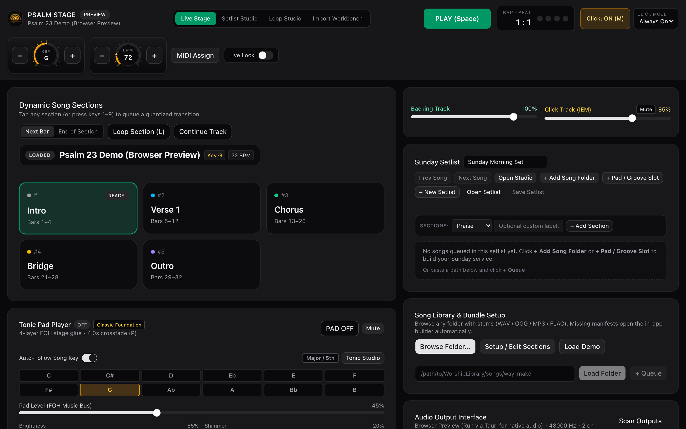

import { Aside } from '@astrojs/starlight/components';

**Live Stage** is the high-contrast, distraction-free performance view built for dimly lit stage laptops and sound booths.

## Top Transport & Beat Pulse

- **Play / Stop (`Space`)**: Starts sample-accurate playback immediately or stops cleanly.
- **Bar : Beat Counter & Beat Dots**: Shows live bar and beat position with an amber accent on **Beat 1** and emerald pulses on beats **2–4**. When the click audio is muted (`M`), the beat dots dim slightly while still keeping visual time for the band.
- **Live Lock**: Locking the stage disables editing tabs (**Setlist Studio**, **Loop Studio**, **Import Workbench**), suppresses external sync interruptions, and engages **screen keep-awake** so your laptop display never sleeps mid-worship.

## Dynamic Song Sections & Quantized Jumps

Section tiles (`Intro`, `Verse`, `Chorus`, `Bridge`, `Outro`, etc.) allow spontaneous worship direction without awkward cuts:

- **Click a Section Tile (or press `1`–`9`)**: Queues the jump according to your active **Quantize Mode**:
  - **Next Bar**: Jumps on the very next bar downbeat.
  - **End of Section**: Finishes the current section cleanly before transitioning.
- **Infinite Loop (`L`)**: Arms the active section to repeat seamlessly with equal-power crossfade boundaries until you press `L` again or queue another section.
- **Continue Until Stopped**: Keeps backing stems or percussion grooves playing smoothly past the end of the arrangement for spoken prayer, altar call, or spontaneous transitions.

## Real-Time Tempo, Key Rotary Dials & Click Modes

- **Key & BPM SVG Rotary Dials**: Adjust transpose (`±12` semitones) and tempo (`BPM`) by dragging the rotary dial ring, tapping `-` / `+` buttons, using keyboard arrow keys, typing a numeric BPM directly, or mapping a physical MIDI encoder directly onto the dial ring.
- **Zero-Latency & Sample-Locked DSP**: Powered by Signalsmith Stretch. At `0` semitone shift and native BPM, Psalm Stage automatically activates **zero-latency bypass**—no spectral processing runs at all. When shifted, click and cues are delayed by the exact stretcher latency (`5,760` samples at `48 kHz`) so transients and metronome stay locked sample-for-sample.
- **Pitch-Preserving Stems**: Stems flagged `"pitched": false` (drums, percussion, click, guide cues) are never pitch-shifted when transposing song keys.
- **Click Modes**:
  - **On**: Metronome audible throughout the song.
  - **Intro Only**: Plays click during the intro count-in and automatically mutes once the main band enters, resetting cleanly if you seek or stop.
  - **Off**: Metronome muted.

## Independent Stage Bus & Stem Mixer

- **Independent Stage Buses**: Control **Master**, **Backing Track**, **Ambient Pad**, **Percussion Groove**, and **Metronome Click** gains independently on Live Stage so backing stems never fight your pad or click levels.
- **Per-Stem Mixer**: Each loaded song exposes per-stem level faders, mute, and solo controls. Mixer levels are preserved cleanly across setlist switches and saved with your setlist.

## Live Setlist Queue & `+ New Setlist` Drawer

- Manage your active Sunday service queue directly on stage, jump between songs with `Prev Song` / `Next Song`, or click **`+ New Setlist`** to save your current arrangement to Managed Setlists and start a fresh named setlist without leaving Live Stage.

<Aside type="tip">
  Need separate click/cue routing for the drummer or worship leader? Switch between **Split L/R** and **Multi-Out** in the Stage Audio Routing bar—hotplugged USB interfaces like a Focusrite Scarlett are detected automatically.
</Aside>
