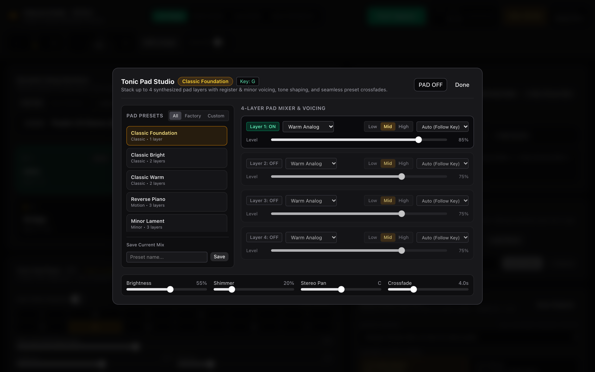
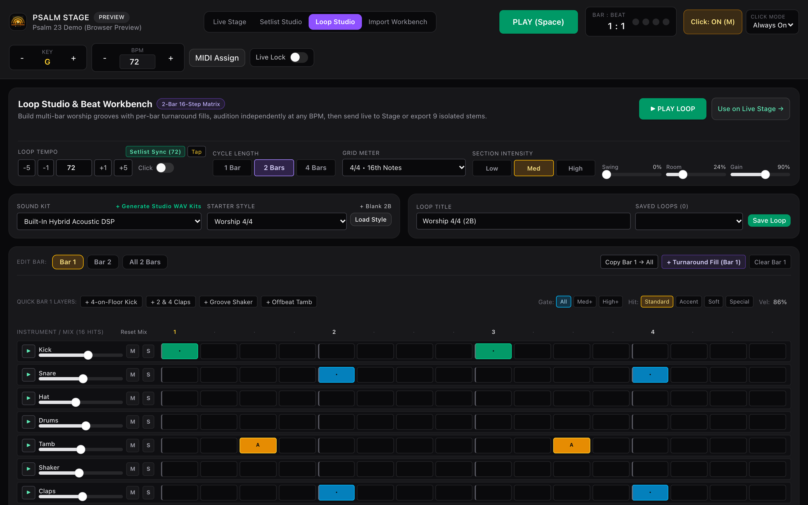

Psalm Stage includes two built-in real-time synthesis engines so you never run out of musical glue—even for songs without stems.

## Tonic Pad Player & Pad Studio

The **Tonic Pad Player** provides continuous ambient stage pads across all 12 chromatic keys (`C` through `B`), supporting both **Major** and **Minor** voicings:

- **Quick Toggle (`P`)**: Turn the pad on or off anytime—even while the multitrack transport is stopped for prayer, Scripture reading, or transitions.
- **Smooth Key Crossfades**: Switching pad keys applies an equal-power crossfade with zero clicks or abrupt drops.
- **Pad Studio Layers & Presets**:
  - Blend multiple voice archetypes, adjust brightness/shimmer, octave register, and stereo pan.
  - Choose from factory presets or save your own custom presets.
- **Preset Lock vs. Pass-Through**:
  - **Preset Lock**: Keeps your chosen pad preset consistent across the whole setlist while automatically following each song's key.
  - **Pass-Through**: Lets each setlist slot recall its own dedicated pad voicing.

---

## Dynamic Percussion Engine & Loop Studio

Need live rhythmic energy without full backing tracks? The built-in percussion engine stays sample-locked to the metronome and any active tempo/key shifts.

### Built-In Groove Styles
Switch styles live or per setlist slot:
- **Worship 4/4** & foundational praise grooves
- **Afrobeat**, **Makossa**, and **Woro**
- **Funk** and **Low / Medium / High** groove intensity levels

### 9-Instrument Percussion Mixer
Adjust levels, mute, or solo individual kit voices independently—including kick, snare, hats, shaker, congas, talking drum/toms, cowbell/agogo, and room ambience.

### Authoring Custom Loops in Loop Studio
1. Switch to the **Loop Studio** tab in the top navigation bar.
2. Audition patterns live and sync directly to your setlist BPM.
3. Program **1-bar to 4-bar variations** with turnaround fills across grid meters (switching meters rescales step hits proportionally onto beat columns).
4. Save custom patterns so they immediately appear in **Live Stage** and **Setlist Studio** batch style pickers.
5. **Export 9-Stem Bundles**: Export any custom groove as a standard multi-stem song bundle (`WAV` + `manifest.json`, with stems marked `"pitched": false`) or generate studio percussion kits for sharing with your team.
